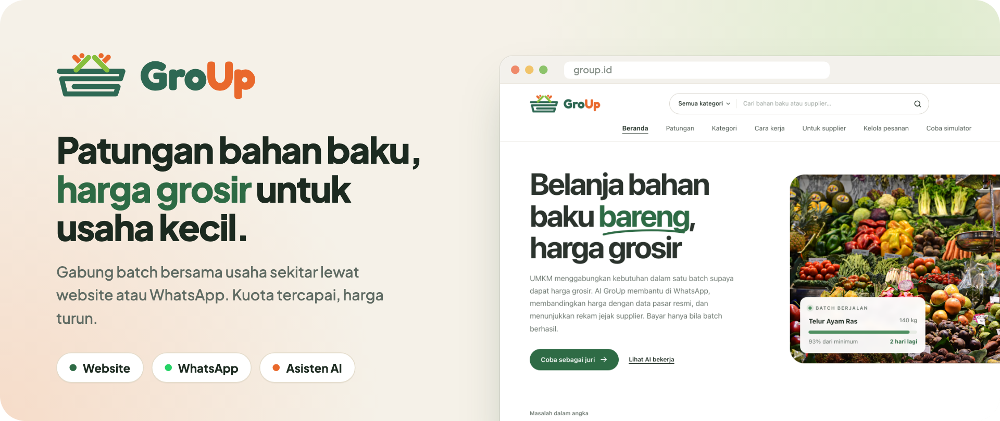
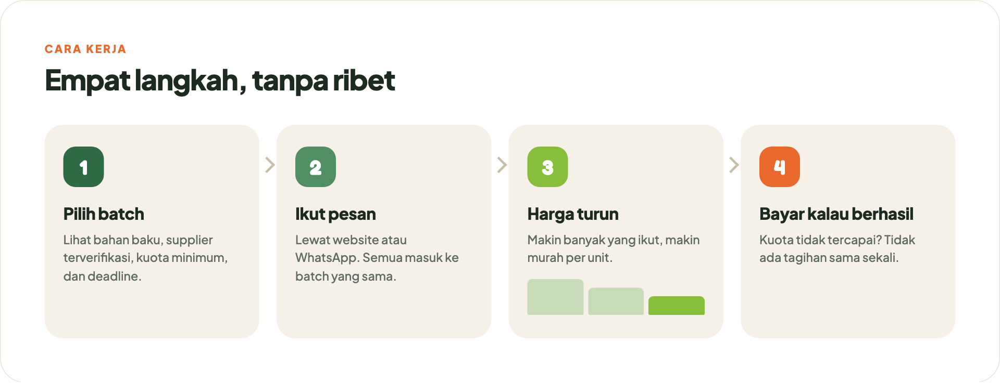
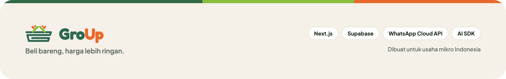

<p align="center">
  
</p>

<p align="center">
  <a href="#mulai-cepat"><b>Mulai cepat</b></a> ·
  <a href="#fitur"><b>Fitur</b></a> ·
  <a href="#coba-sebagai-juri"><b>Mode demo</b></a> ·
  <a href="#panduan-teknis"><b>Panduan teknis</b></a>
</p>

<p align="center">
  
  
  
  
</p>

## Apa itu GroUp?

Warung dan usaha kecil biasanya beli bahan baku sedikit-sedikit, jadi harganya mahal. **GroUp** mengumpulkan pesanan banyak usaha ke dalam satu **batch** supaya bisa dapat harga grosir dari supplier. Pesanan bisa lewat **website**, **WhatsApp**, atau **simulator WhatsApp**, dan semuanya masuk ke batch yang sama.

<p align="center"></p>

## Fitur

| | |
|---|---|
| **Katalog patungan** | Cari batch, filter kategori, lihat progres kuota dan tier harga. |
| **Pesan via WhatsApp** | Kirim `MULAI`, pilih batch, isi jumlah, konfirmasi. |
| **Simulator WhatsApp** | Coba alur WhatsApp dari website, lengkap dengan panel "Di balik layar". |
| **Agen AI** | Memahami pesan bebas. Aksi yang mengubah data tetap butuh tombol konfirmasi. |
| **Tiga peran** | Dashboard terpisah untuk admin, grosir, dan pembeli. |

<p align="center"></p>

<p align="center"></p>

### Siapa melakukan apa

| Peran | Halaman | Bisa apa |
|---|---|---|
| **Pembeli** | `/akun` | Lihat pesanan dengan timeline kuota → bayar → serah, ubah atau batalkan selama batch terbuka. |
| **Grosir** | `/grosir` | Buka batch (foto + asisten harga), tutup batch, pantau radar permintaan, atur profil. |
| **Admin** | `/admin` | KPI, kelola batch dan pesanan, verifikasi supplier, pantau aktivitas AI. |

Batch ditutup setelah deadline. Kalau di bawah minimum, statusnya *tidak tercapai* dan tidak ada tagihan. Kalau minimum tercapai, harga final dibekukan dan pesanan menjadi *menunggu bayar*.

## Mulai cepat

```bash
npm install
npm run dev
```

Buka <http://localhost:3000>. Tanpa kredensial pun website sudah menampilkan batch contoh. Untuk menyimpan pesanan, siapkan Supabase (lihat [panduan teknis](#panduan-teknis)).

## Coba sebagai juri

Isi akun demo `DEMO_*` di `.env.local`, lalu:

```bash
npm run demo:seed
```

Di `/masuk`, pilih **Coba sebagai Pembeli / Grosir / Admin** untuk langsung masuk tanpa mengetik kata sandi. Data demo kembali ke keadaan awal setiap malam.

Seed membuat 8 batch bahan pokok dengan harga yang mengikuti pasar Bandung. Patungan hanya memangkas sebagian margin distribusi, jadi hematnya 3–12%, bukan separuh harga:

| Batch | Status | Tier 1 / tier 2 (% harga PIHPS) |
|---|---|---|
| Cabai Merah Keriting | Terbuka | 92% / 88% |
| Bawang Merah | Terbuka | 93% / 89% |
| Telur Ayam Ras | Terbuka | 97% / 95% |
| Daging Ayam Ras | Terbuka | 96% / 94% |
| Beras Medium | Berhasil, menunggu bayar | 97% / 95% |
| Gula Pasir | Berhasil, siap diambil | 97% / 95% |
| Minyak Goreng Curah | Berhasil, sudah diambil | 97% / 95% |
| Bawang Putih | Tidak tercapai | 93% / 89% |

Dasarnya margin perdagangan dan pengangkutan BPS: cabai ±25%, bawang ±23%, daging ayam ±12%, beras, minyak, gula, dan telur ±9–11%. Tier 1 memangkas sekitar sepertiga margin itu, tier 2 sekitar setengahnya.

Foto tiap batch ada di `scripts/demo/images/` dan diunggah ke bucket `batch-images` saat seed.

## Isi repo

| Folder | Isi |
|---|---|
| `app/` | Halaman website, dashboard, dan API |
| `lib/agent/` | Otak chat WhatsApp dan simulator |
| `lib/trust/` | Cek harga wajar, kartu supplier, radar permintaan |
| `supabase/` | Skema database dan tes |
| `ai/` · `evals/` · `models/` | Data harga, pelatihan, dan evaluasi AI |

## Tes

```bash
npm test                 # Vitest + pytest pipeline harga (SKIP_PYTEST=1 untuk melewati pytest)
npx tsc --noEmit && npm run lint && npm run build
supabase start && supabase db reset && supabase test db   # tes pgTAP, butuh Docker + Supabase CLI
```

> [!NOTE]
> Pembayaran dan logistik belum terintegrasi. Admin mencatat status pembayaran, penyerahan, dan jadwal batch secara manual.

## Panduan teknis

Klik untuk membuka tiap bagian.

<details>
<summary><b>Supabase dan akun</b></summary>

1. Buat proyek Supabase dan buat file lokal `.env.local` di root proyek.
2. Isi `NEXT_PUBLIC_SUPABASE_URL`, `NEXT_PUBLIC_SUPABASE_PUBLISHABLE_KEY`, dan `SUPABASE_SECRET_KEY`. Jangan pernah menaruh secret key di variabel `NEXT_PUBLIC_` atau di browser.
3. Terapkan semua file di `supabase/migrations/` secara berurutan lewat Supabase SQL Editor atau `supabase db push`:

   | Migrasi | Isi |
   |---|---|
   | `20261030165820_create_patungan_ordering.sql` | Skema awal patungan |
   | `20261103090000_align_with_design.sql` | Penyesuaian dengan desain |
   | `20261106090000_agent_router.sql` | Kanal `simulator`, tabel `agent_messages`, `agent_traces`, `demand_interests`, kolom `channel` dan `pending_action` di `whatsapp_sessions`, batas 50 pesanan simulator aktif per batch, fungsi `purge_simulator_orders` dan `cleanup_agent_data` |
   | `20261112090000_storage_buckets.sql` | Bucket `batch-images` (foto batch) dan `site-media` |
   | `20261113090000_roles_and_demo.sql` | `suppliers.owner_user_id`, `orders.buyer_user_id`, kolom `tools` di trace agen, penanda `demo_seed`, fungsi `link_supplier_owner` dan `reset_demo_data` |
   | `20261114090000_supplier_trust.sql` | Cache ringkasan kepercayaan supplier |

4. Aktifkan Email/Password di Supabase Auth. Peran akun disimpan di `app_metadata.role` (`admin`, `grosir`, atau `pembeli`) dan hanya bisa diubah dengan service role. Tidak ada pendaftaran publik. Untuk admin pertama, jalankan di SQL Editor proyek sendiri (ganti alamatnya):

   ```sql
   update auth.users
   set raw_app_meta_data = coalesce(raw_app_meta_data, '{}'::jsonb) || '{"role":"admin"}'::jsonb
   where email = 'admin@contoh.id';
   ```

   Jangan gunakan `user_metadata` sebagai sumber otorisasi. Keluar lalu masuk kembali agar token sesi memuat peran baru.

5. Masuk di `/masuk`. `proxy.ts` membatasi `/admin` untuk admin, `/grosir` untuk grosir, dan `/akun` untuk pembeli. Tanpa sesi, user dialihkan ke `/masuk`; dengan peran lain, ke dashboard miliknya.
   - **Admin** (`/admin`): ringkasan KPI dan pembagian pesan per jalur agen; batch dan pesanan dengan filter status (tutup batch, catat pembayaran dan penyerahan); verifikasi supplier dan hubungkan akun grosir (isi kata sandi untuk membuat akun grosir baru); Aktivitas AI dari `agent_traces`.
   - **Grosir** (`/grosir`): ringkasan dan progres kuota, batch milik suppliernya (bisa ditutup), buka batch dengan upload foto dan asisten harga, radar permintaan, profil dengan pratinjau kartu kepercayaan.
   - **Pembeli** (`/akun`): ringkasan dan pesanan dengan timeline kuota → pembayaran → penyerahan; jumlah bisa diubah atau dibatalkan selama batch terbuka. Pesanan web yang dibuat saat login otomatis tercatat di akun.

</details>

<details>
<summary><b>Halaman publik</b></summary>

Semua halaman publik berada di `app/(site)/` dan memakai header (pencarian + kategori) serta footer yang sama.

| Rute | Isi |
|---|---|
| `/` | Hero dengan video demo, harga pasar vs patungan, tiga manfaat AI, simulator, strip metrik eval, tombol "Coba sebagai …", kategori, batch minggu ini, hitung mundur batch terdekat |
| `/patungan` | Katalog batch terbuka dengan pencarian, filter (kategori, hampir capai kuota, tutup ≤ 3 hari, supplier terverifikasi), dan urutan. Filter tersimpan di URL, misalnya `/patungan?kategori=sayuran&sort=progres` |
| `/patungan/<id>` | Detail batch: tier harga, aturan pembayaran/penyerahan, riwayat batch supplier, form pesanan |
| `/kategori`, `/kategori/<slug>` | Daftar kategori dan katalog per kategori |
| `/cara-kerja` | Alur patungan, simulasi harga bertingkat, perintah WhatsApp, FAQ |
| `/supplier` | Informasi dan pendaftaran mitra supplier lewat email |
| `/pesanan` | Ubah jumlah atau batalkan pesanan website memakai kode pengelolaan yang ditampilkan sekali saat pesanan dibuat |
| `/simulator` | Simulator WhatsApp |
| `/transparansi-ai` | Penjelasan cara AI dipakai |

</details>

<details>
<summary><b>Halaman depan dan video demo</b></summary>

Hero menampilkan video demo dari `NEXT_PUBLIC_DEMO_VIDEO_URL` dan `NEXT_PUBLIC_DEMO_POSTER_URL`; tanpa env ini tampil gambar statis. Perbandingan harga pasar disembunyikan bila tidak ada data pasar. Strip metrik memakai `evals/summary.ts` (sama dengan `eval:report`) dan hanya tampil bila hasil eval router ada dan `ai/data/test.jsonl` tidak kosong.

Rekam video (butuh `ffmpeg` di PATH dan browser Playwright, sekali: `npx playwright install chromium`):

```bash
npm run demo:seed
npm run build && npm start          # terminal lain
npm run demo:record                 # DEMO_BASE_URL bawaan http://localhost:3000
```

Skrip merekam simulator, detail batch, radar dan asisten harga sebagai grosir, serta Aktivitas AI sebagai admin, lalu mengonversi ke MP4 (H.264, `+faststart`) dan poster JPG, mengupload ke bucket `site-media`, dan mencetak nilai env yang perlu diisi. Langkah yang gagal menghentikan rekaman, jadi skrip ini juga uji asap end-to-end.

Bagian "Lihat satu chat jadi keputusan" memutar tiga klip simulator asli dari `public/demo/` (WebM, poster JPG, caption VTT). Langkah agen di sampingnya menyala sesuai waktu di `lib/demo-clips.json`. Rekam ulang tanpa ffmpeg:

```bash
npm run demo:clips -- --base https://gro-up-virid.vercel.app --channel msedge   # --only <id> untuk satu skenario
```

Skenario dan teksnya ada di `lib/demo-clips.ts`. Setiap klip hanya disimpan bila balasan agen sesuai harapan (tombol konfirmasi, jawaban dari PIHPS, atau perintah manipulatif dialihkan ke menu); kalau tidak, dicoba ulang sampai tiga kali.

</details>

<details>
<summary><b>AI kepercayaan</b></summary>

Semua angka dihitung dari data, dan fitur disembunyikan bila datanya tidak cukup. Fitur yang dibantu AI diberi label "Dibantu AI" yang menautkan ke `/transparansi-ai`.

- **Cek harga wajar** (`lib/trust/fair-price.ts`): harga tier saat ini dibanding harga PIHPS Kota Bandung untuk bahan dan satuan yang sama, di kartu dan detail batch, beserta prediksi bulan depan dari `ai/harga/output/prediksi.json` (model dan galat validasinya ikut ditampilkan). Ringkasan pembeli menghitung total hemat dari pesanan yang punya data pasar.
- **Kartu kepercayaan supplier** (`lib/trust/supplier.ts`): fakta dari database plus ringkasan 1–2 kalimat dari model tahap 2. Ringkasan dengan angka atau bulan yang tidak ada di fakta (`isGrounded`), error, atau lewat 5 detik diganti template. Hasilnya di-cache di `suppliers.trust_summary` selama 24 jam atau sampai faktanya berubah.
- **Radar permintaan** (`lib/trust/demand-radar.ts`, `/grosir/radar`): minat aktif dikelompokkan per bahan, dengan kuantitas mingguan per satuan, permintaan sekali beli, tren 14 hari, dan harga pasar. Bahan dengan kurang dari 2 pengirim tidak ditampilkan.
- **Asisten buka batch**: saran tier 95% dan 90% dari harga pasar (dibulatkan ke bawah ke Rp100), kuota minimum dari radar, dan peringatan bila ada tier ≥ harga pasar. Peringatan tidak memblokir penyimpanan.

</details>

<details>
<summary><b>Mode demo</b></summary>

Isi `DEMO_PEMBELI_EMAIL/PASSWORD`, `DEMO_GROSIR_EMAIL/PASSWORD`, dan `DEMO_ADMIN_EMAIL/PASSWORD` di `.env.local` (dan di Vercel), lalu jalankan:

```bash
npm run demo:seed                  # idempoten; memakai SUPABASE_SECRET_KEY
npm run demo:seed -- --tanpa-llm   # trace simulasi tanpa memanggil LLM tahap 2
```

Skrip ini membuat 3 akun demo, supplier "Grosir Demo" (terverifikasi, milik akun grosir demo), 8 batch bahan PIHPS di berbagai status (persen tier per komoditas ada di `TIER_PCT`, `scripts/demo/plan.ts`), pesanan pembeli demo, ±36 minat permintaan dari 15 pengirim fiktif, dan ±200 trace agen dari skenario simulator. Bila tahap 2 dikonfigurasi, skenario memakai LLM dengan cache di `evals/cache/demo-seed`, jadi pesan yang berulang hanya memanggil model sekali.

Di `/masuk`, blok "Coba sebagai juri" login ke akun demo lewat server action, jadi kata sandi tidak pernah dikirim ke browser. `reset_demo_data()` berjalan setiap malam lewat `cleanup_agent_data()`: data buatan akun demo setelah seed dihapus dan data seed dikembalikan ke keadaan awal.

</details>

<details>
<summary><b>WhatsApp Cloud API</b></summary>

Isi server-side `WHATSAPP_API_VERSION` (format `vNN.N`), `WHATSAPP_ACCESS_TOKEN`, `WHATSAPP_PHONE_NUMBER_ID`, `WHATSAPP_VERIFY_TOKEN`, dan `WHATSAPP_APP_SECRET`. Opsional, isi `NEXT_PUBLIC_WHATSAPP_NUMBER` (kode negara dan angka saja) agar website menampilkan tautan WhatsApp.

Daftarkan callback Meta ke `https://<domain-publik>/api/whatsapp/webhook`, masukkan verify token yang sama, lalu subscribe ke event `messages`. Webhook harus memakai HTTPS yang dapat dijangkau Meta; pengembangan lokal bisa memakai tunnel HTTPS.

| Perintah | Fungsi |
|---|---|
| `MULAI` | Pilih batch, baca aturan, isi jumlah, konfirmasi |
| `PESANAN` | Tampilkan pesanan aktif dari nomor yang sama |
| `UBAH <kode> <jumlah>` | Ubah jumlah (setelah tombol konfirmasi) selama batch terbuka |
| `BATAL <kode>` | Batalkan pesanan (setelah tombol konfirmasi) selama batch terbuka |
| `BATAL` | Tutup pertanyaan yang sedang berjalan |

Webhook memverifikasi signature, mengabaikan ID pesan duplikat, dan memproses pesan setelah respons dikirim (`after()`).

</details>

<details>
<summary><b>Simulator WhatsApp</b></summary>

Buka `/simulator` (tautan "Coba simulator" di header dan footer). Simulator memanggil `POST /api/simulator/message` dan memakai engine yang sama dengan webhook WhatsApp (`lib/agent/`), jadi alurnya identik: kirim `MULAI`, tekan "Pilih batch", pilih baris, isi jumlah, lalu tekan "Ya, ikut". Panel "Di balik layar" menampilkan jalur, alasan, guard aktif, tahap, intent, keyakinan, slot, tool, latensi, dan token tiap pesan.

- Identitas pengunjung disimpan di cookie `sim_session` (httpOnly, 7 hari). Pesanan tercatat dengan kanal `simulator` dan nama usaha yang diisi pengunjung di atas chat (wajib, 2–80 karakter, disimpan di `localStorage` browser), setara nama profil WhatsApp.
- Paling banyak 50 pesanan simulator aktif per batch. Pengelola bisa menghapus semua pesanan simulator di batch terbuka lewat tombol "Hapus pesanan simulator" di dasbor admin (`DELETE /api/admin/simulator-orders`).
- Endpoint simulator publik. Sebelum demo, pasang rate limit Vercel WAF 30 permintaan per menit per IP (butuh `vercel link`):

  ```bash
  vercel firewall rules add "Rate limit simulator" \
    --condition '{"type":"path","op":"eq","value":"/api/simulator/message"}' \
    --action rate_limit \
    --rate-limit-window 60 \
    --rate-limit-requests 30 \
    --rate-limit-keys ip \
    --rate-limit-action deny --yes
  vercel firewall diff
  vercel firewall publish --yes
  ```

</details>

<details>
<summary><b>Agen AI</b></summary>

Teks bebas dari WhatsApp dan simulator diproses tiga lapis:

1. **Perintah baku** (`MULAI`, `PESANAN`, `UBAH`, `BATAL`, tombol) tanpa AI.
2. **Tahap 1:** classifier intent lokal (ONNX, `models/intent-classifier/`). Selama artefak model belum ada, lapis ini dilewati.
3. **Tahap 2:** model bahasa dengan tools baca-saja (`cari_batch`, `detail_batch`, `pesanan_saya`, `harga_pasar`). Teks dan riwayat diredaksi dulu (nomor telepon, email, deret angka panjang), angka di jawaban harus ada di hasil tool, dan setiap pengirim dibatasi 20 panggilan per jam (panggilan yang gagal ikut dihitung).

Setiap aksi yang mengubah data tetap butuh tombol konfirmasi. Balasan AI diberi awalan 🤖, dan balasan AI pertama dalam 24 jam menautkan `/transparansi-ai`.

Harga pasar dibaca dari `ai/harga/output/prediksi.json` (PIHPS Kota Bandung, bulanan). Untuk memperbarui: jalankan pipeline di `ai/harga/` (lihat [README di sana](ai/harga/README.md)), commit `prediksi.json`, lalu push.

**Penyedia model tahap 2**

| Nama | Keterangan |
|---|---|
| `AGENT_STAGE2_PROVIDER` | `gateway` (default, Vercel AI Gateway; butuh kartu kredit terdaftar di akun Vercel), `google` (Gemini), atau `openai-compatible` |
| `AGENT_STAGE2_MODEL` | ID model. Kosong → `nvidia/nemotron-3.5-lightning-free` untuk `gateway`, `gemini-3.5-flash-lite` untuk `google`. Wajib untuk `openai-compatible` |
| `GOOGLE_GENERATIVE_AI_API_KEY` | Kunci Gemini dari https://aistudio.google.com/apikey |
| `AI_GATEWAY_API_KEY` | Kunci AI Gateway untuk lokal (di Vercel cukup OIDC) |
| `AGENT_STAGE2_BASE_URL`, `AGENT_STAGE2_API_KEY` | Endpoint kompatibel OpenAI, misalnya OpenCode Zen `https://opencode.ai/zen/v1`, OpenRouter, atau NVIDIA NIM |
| `AGENT_STAGE2_OUTPUT_MODE` | `json-text` (default) atau `native` (output terstruktur) |

Konfigurasi yang tidak lengkap mematikan tahap 2 dengan peringatan di log; teks bebas dibalas menu. Production saat ini memakai `google`.

**Dataset, pelatihan, dan eval**

```bash
npm run data:check          # validasi format dataset intent
npm run data:generate       # data sintetis lewat penyedia tahap 2 di atas
npm run data:build          # split train/val/test
npm run model:calibrate     # ambang per intent dari val → models/intent-classifier/thresholds.json
npm run eval -- --mode router   # juga: --mode fixed-only, --mode llm-only, --suite <nama>
npm run eval:report         # tulis evals/REPORT.md
```

Pelatihan dijalankan di Colab (`ai/training/intent_classifier.ipynb`). Format dataset: `ai/data/intent_guidelines.md` dan `evals/datasets/README.md`. Hasil eval: [`evals/REPORT.md`](evals/REPORT.md); model card: [`models/intent-classifier/MODEL_CARD.md`](models/intent-classifier/MODEL_CARD.md).

</details>

<details>
<summary><b>Pembersihan data agen</b></summary>

`vercel.ts` mendaftarkan Vercel Schedule `agent-cleanup` setiap hari pukul 02.00 WIB yang memanggil `GET /api/cron/cleanup`. Endpoint ini menolak permintaan tanpa header `Authorization: Bearer <CRON_SECRET>`, lalu menjalankan `cleanup_agent_data`: riwayat pesan dan ID pesan masuk dihapus setelah 30 hari, trace setelah 90 hari, sesi yang kedaluwarsa, lalu `reset_demo_data()` untuk mode demo. Schedule hanya berjalan di deployment production. Untuk menjalankannya manual:

```bash
curl -H "Authorization: Bearer $CRON_SECRET" https://<domain>/api/cron/cleanup
```

</details>

<details>
<summary><b>Variabel lingkungan tambahan</b></summary>

| Nama | Keterangan |
|---|---|
| `NEXT_PUBLIC_SITE_URL` | URL publik situs, dipakai di tautan balasan agen. Di Vercel jatuh ke `VERCEL_PROJECT_PRODUCTION_URL` bila kosong |
| `CRON_SECRET` | String acak ≥ 16 karakter (huruf dan angka) untuk endpoint pembersihan |
| `DEMO_PEMBELI_EMAIL`, `DEMO_PEMBELI_PASSWORD`, `DEMO_GROSIR_EMAIL`, `DEMO_GROSIR_PASSWORD`, `DEMO_ADMIN_EMAIL`, `DEMO_ADMIN_PASSWORD` | Akun demo untuk "Coba sebagai juri" di `/masuk` dan `npm run demo:seed` |
| `NEXT_PUBLIC_DEMO_VIDEO_URL`, `NEXT_PUBLIC_DEMO_POSTER_URL` | Video dan poster hero halaman depan, dicetak oleh `npm run demo:record` |
| `AGENT_ENABLED` | `false` mematikan pemahaman teks bebas; teks bebas hanya dibalas menu (sakelar darurat) |

</details>

<p align="center">
  
</p>
