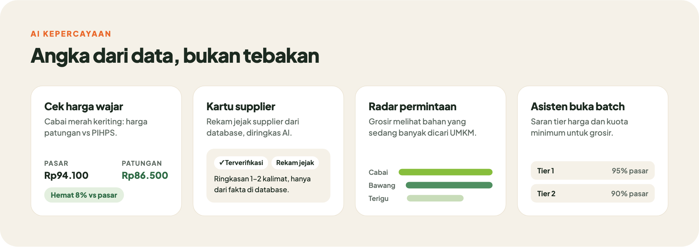
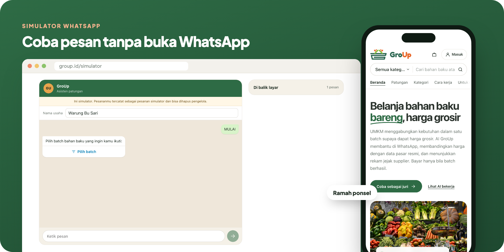
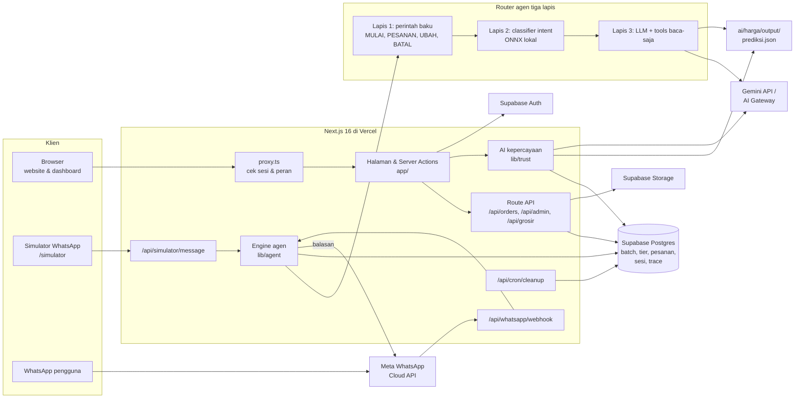

<p align="center">
  
</p>

<p align="center">
  <a href="#tim"><b>Tim</b></a> ·
  <a href="#fitur"><b>Fitur</b></a> ·
  <a href="#arsitektur-sistem-dan-alur-data"><b>Arsitektur</b></a> ·
  <a href="#instalasi-dan-menjalankan-aplikasi"><b>Instalasi</b></a> ·
  <a href="#akun-demonstrasi"><b>Akun demo</b></a> ·
  <a href="#penggunaan-ai"><b>AI</b></a> ·
  <a href="#atribusi"><b>Atribusi</b></a>
</p>

<p align="center">
  
  
  
  
</p>

## Tim

**Nama tim:** KitaMasihPemula

| No | Nama | Peran |
|---|---|---|
| 1 | Ghina Emelia Yantes | Full Stack|
| 2 | Muhammad Rafiif Ansyadya | AI/LLM |
| 3 | Pelangi Putri Sanyoto | Finance |
| 4 | Visakha Harumi Hendrawan | Product Manager |

## Tentang aplikasi

| | |
|---|---|
| **Kategori** | Web |
| **Nama aplikasi** | GroUp |
| **Demo** | <https://gro-up-virid.vercel.app> |

### Masalah yang diangkat

**Subtema yang diangkat:** Local MSME & Creative Economy

Pelaku UMKM kuliner kerap menghadapi kendala dalam pengadaan bahan baku karena pembelian skala kecil memaksa mereka membayar harga eceran. Di sisi lain, harga grosir hanya berlaku untuk pembelian dalam jumlah besar yang melampaui kapasitas modal dan penyimpanan mereka. Permasalahan ini diperparah oleh minimnya informasi untuk menilai kewajaran harga pasar serta mengidentifikasi pemasok yang kredibel.

### Solusi

**GroUp** mengumpulkan pesanan dari berbagai usaha ke dalam satu **batch** (patungan) agar dapat memperoleh **harga grosir bertingkat** dari *supplier*. Semakin banyak pihak yang bergabung, semakin murah pula harga yang didapatkan. Pembeli hanya perlu melakukan pembayaran apabila **kuota minimum batch** telah terpenuhi. Pemesanan dapat dilakukan secara fleksibel melalui **website**, **WhatsApp**, maupun **simulator WhatsApp**, dengan seluruh data pesanan yang terintegrasi ke dalam **batch** yang sama. Selain itu, teknologi **AI** hadir untuk membantu membandingkan harga dengan **harga pasar resmi (MVP: data PIHPS Kota Bandung)**, merangkum **rekam jejak supplier**, serta menerjemahkan dan memahami **pesan WhatsApp** yang ditulis secara bebas oleh pengguna.

### Target pengguna

- **Pembeli:** pelaku UMKM kuliner (warung makan, katering, pedagang gorengan, kedai) di Kota Bandung.
- **Grosir/supplier:** pedagang besar bahan pokok yang ingin menjual dalam volume pasti.
- **Admin:** pengelola platform yang memverifikasi supplier dan mencatat pembayaran serta penyerahan.

<p align="center"></p>

## Fitur

Semua fitur di bawah sudah diimplementasikan dan bisa dicoba di demo.

| | |
|---|---|
| **Katalog patungan** | Cari batch, filter kategori, lihat progres kuota dan tier harga. |
| **Harga bertingkat** | Harga turun otomatis per tier saat total pesanan naik; harga final dibekukan saat batch ditutup. |
| **Pesan lewat website** | Form pesanan di detail batch; ubah atau batalkan pesanan di `/pesanan` dengan kode pengelolaan. |
| **Pesan via WhatsApp** | Kirim `MULAI`, pilih batch, isi jumlah, konfirmasi. Juga ada `PESANAN` untuk mengecek pesanan pribadi, `UBAH` untuk meminta perubahan pesanan, dan `BATAL` untuk membatalkan proses. |
| **Simulator WhatsApp** | Coba alur WhatsApp dari website, lengkap dengan panel "Di balik layar". |
| **Agen AI** | Memahami pesan bebas. Aksi yang mengubah data tetap butuh tombol konfirmasi. |
| **Cek harga wajar** | Harga batch dibanding harga pasar PIHPS Kota Bandung, plus prediksi bulan depan. |
| **Kartu kepercayaan supplier** | Fakta rekam jejak supplier dari database dengan ringkasan singkat dari AI. |
| **Radar permintaan** | Grosir melihat bahan yang sedang banyak dicari pembeli. |
| **Asisten buka batch** | Saran harga tier dan kuota minimum, plus upload foto batch. |
| **Tiga peran** | Dashboard terpisah untuk admin, grosir, dan pembeli, dengan login berbasis peran. |
| **Aktivitas AI** | Admin memantau jalur, intent, tool, latensi, dan token setiap pesan yang diproses agen. |
| **Transparansi AI** | Halaman `/transparansi-ai` dan label "Dibantu AI" di setiap fitur yang memakai AI. |

<p align="center"></p>

<p align="center"></p>

### Siapa melakukan apa

| Peran | Halaman | Bisa apa |
|---|---|---|
| **Pembeli** | `/akun` | Lihat pesanan dengan timeline kuota → bayar → serah, ubah atau batalkan selama batch terbuka. |
| **Grosir** | `/grosir` | Buka batch (foto + asisten harga), tutup batch, pantau radar permintaan, atur profil. |
| **Admin** | `/admin` | KPI, kelola batch dan pesanan, verifikasi supplier, pantau aktivitas AI. |

Batch ditutup setelah deadline. Kalau di bawah minimum, statusnya *tidak tercapai* dan tidak ada tagihan. Kalau minimum tercapai, harga final dibekukan dan pesanan menjadi *menunggu bayar*.

## Teknologi

| Lapisan | Yang dipakai |
|---|---|
| **Framework** | [Next.js 16](https://nextjs.org) (App Router, Server Actions, `proxy.ts`), [React 19](https://react.dev), TypeScript 5.9 |
| **Library** | [AI SDK 7](https://ai-sdk.dev) (`ai`, `@ai-sdk/google`, `@ai-sdk/openai-compatible`), [Zod 4](https://zod.dev), [`@supabase/ssr`](https://supabase.com/docs/guides/auth/server-side) dan `@supabase/supabase-js`, [`@huggingface/transformers`](https://huggingface.co/docs/transformers.js) (classifier ONNX) |
| **Database & storage** | [Supabase](https://supabase.com): PostgreSQL, Auth (email/kata sandi, peran di `app_metadata`), Storage (`batch-images`, `site-media`), Row Level Security |
| **API & layanan pihak ketiga** | [WhatsApp Cloud API](https://developers.facebook.com/docs/whatsapp/cloud-api) (Meta), [Google Gemini API](https://ai.google.dev) (model tahap 2 di production), [Vercel AI Gateway](https://vercel.com/ai-gateway) (alternatif), data harga [PIHPS Nasional](https://www.bi.go.id/hargapangan) (Bank Indonesia) dan SP2KP (Kemendag) |
| **Hosting** | [Vercel](https://vercel.com): Fluid Compute, Vercel Schedules (cron pembersihan), Vercel WAF (rate limit simulator); konfigurasi di `vercel.ts` (`@vercel/config`) |
| **AI/ML (Python)** | pandas, scikit-learn, LightGBM, joblib (pipeline harga di `ai/harga/`); Transformers + Optimum + ONNX Runtime (pelatihan classifier di Colab) |
| **Pengujian** | Vitest, pytest, pgTAP (`supabase test db`), Playwright (rekam demo), ESLint |

## Arsitektur sistem dan alur data



**Alur data pesanan**

1. Grosir membuka batch (bahan, foto, tier harga, kuota minimum, deadline). Data tersimpan di tabel batch dan tier; foto di bucket `batch-images`.
2. Pembeli memesan dari website, WhatsApp, atau simulator. Ketiga kanal menulis ke tabel pesanan yang sama melalui fungsi database, sehingga kuota dan tier harga dihitung sekali di satu tempat.
3. Pesan WhatsApp dan simulator diproses engine agen: perintah baku dulu, lalu classifier intent, lalu LLM. LLM hanya bisa memanggil tools baca-saja; aksi yang mengubah data harus dikonfirmasi pengguna dengan tombol. Setiap langkah dicatat di `agent_traces`.
4. Setelah deadline, batch ditutup. Bila kuota minimum tercapai, harga final dibekukan dan pesanan menjadi *menunggu bayar*; bila tidak, batch *tidak tercapai* tanpa tagihan.
5. Admin mencatat pembayaran dan penyerahan. Cron harian menghapus data agen lama dan mengembalikan data demo ke awal.
6. Harga pasar dibaca dari `prediksi.json` yang dihasilkan pipeline Python `ai/harga/` dari data PIHPS dan SP2KP.

## Instalasi dan menjalankan aplikasi

**Prasyarat:** Node.js 24 LTS, npm, akun [Supabase](https://supabase.com). Opsional: Supabase CLI + Docker (tes database), Python 3.13 (pipeline harga), `ffmpeg` (rekam video demo).

```bash
git clone https://github.com/ghinayantes/GroUp.git
cd GroUp
npm install
cp .env.example .env.local     # lalu isi nilainya (lihat tabel di bawah)
npm run dev
```

Buka <http://localhost:3000>. Tanpa kredensial pun website sudah menampilkan batch contoh. Untuk menyimpan pesanan:

1. Buat proyek Supabase, isi tiga variabel Supabase di `.env.local`.
2. Terapkan migrasi: `supabase link --project-ref <ref>` lalu `supabase db push` (atau jalankan file `supabase/migrations/` berurutan di SQL Editor).
3. Aktifkan Email/Password di Supabase Auth.
4. Isi akun `DEMO_*`, lalu jalankan `npm run demo:seed` untuk membuat akun demo, supplier, batch, pesanan, dan foto.

Build production: `npm run build && npm start`. Deploy: hubungkan repo ke Vercel dan isi variabel yang sama di Project Settings → Environment Variables.

### Konfigurasi tambahan per fitur

| Fitur | Yang perlu disiapkan |
|---|---|
| Login & dashboard | Supabase Auth; admin pertama dibuat lewat SQL (lihat [Supabase dan akun](#panduan-teknis)) |
| WhatsApp asli | Aplikasi Meta + nomor WhatsApp Business, isi `WHATSAPP_*`, daftarkan webhook `https://<domain>/api/whatsapp/webhook` |
| Pemahaman teks bebas (tahap 2) | Kunci Gemini (`GOOGLE_GENERATIVE_AI_API_KEY`) atau AI Gateway / endpoint kompatibel OpenAI |
| Classifier tahap 1 | Latih di Colab (`ai/training/intent_classifier.ipynb`), taruh artefak di `models/intent-classifier/` |
| Harga pasar | Python 3.13, jalankan `python train.py` di `ai/harga/` |
| Cron pembersihan | `CRON_SECRET` di Vercel; schedule terdaftar di `vercel.ts` |
| Rate limit simulator | Aturan Vercel WAF (perintah di [Simulator WhatsApp](#panduan-teknis)) |
| Video & klip demo | `ffmpeg` dan `npx playwright install chromium` |

### Variabel lingkungan (`.env.example`)

| Variabel | Wajib | Keterangan |
|---|---|---|
| `NEXT_PUBLIC_SUPABASE_URL` | Ya | URL proyek Supabase |
| `NEXT_PUBLIC_SUPABASE_PUBLISHABLE_KEY` | Ya | Publishable key Supabase (aman di browser) |
| `SUPABASE_SECRET_KEY` | Ya | Secret key Supabase, hanya di server |
| `NEXT_PUBLIC_SITE_URL` | Tidak | URL publik situs untuk tautan di balasan agen |
| `NEXT_PUBLIC_WHATSAPP_NUMBER` | Tidak | Nomor WhatsApp (kode negara + angka) untuk tautan di website |
| `CRON_SECRET` | Production | String acak ≥ 16 karakter untuk `/api/cron/cleanup` |
| `WHATSAPP_API_VERSION` | WhatsApp | Versi Graph API, format `vNN.N` |
| `WHATSAPP_PHONE_NUMBER_ID` | WhatsApp | ID nomor pengirim |
| `WHATSAPP_ACCESS_TOKEN` | WhatsApp | Token akses Cloud API |
| `WHATSAPP_APP_SECRET` | WhatsApp | Untuk verifikasi signature webhook |
| `WHATSAPP_VERIFY_TOKEN` | WhatsApp | Token verifikasi saat mendaftarkan webhook |
| `AGENT_ENABLED` | Tidak | `false` mematikan pemahaman teks bebas |
| `AGENT_STAGE2_PROVIDER` | Tidak | `google` (production), `gateway`, atau `openai-compatible` |
| `AGENT_STAGE2_MODEL` | Tidak | ID model; kosong memakai default penyedia |
| `AGENT_STAGE2_OUTPUT_MODE` | Tidak | `json-text` (default) atau `native` |
| `AGENT_STAGE2_THINKING_LEVEL` | Tidak | Khusus `google`: `minimal`, `low`, `medium`, `high` |
| `GOOGLE_GENERATIVE_AI_API_KEY` | Tahap 2 | Kunci Gemini API |
| `AI_GATEWAY_API_KEY` | Tahap 2 | Kunci Vercel AI Gateway (lokal) |
| `AGENT_STAGE2_BASE_URL`, `AGENT_STAGE2_API_KEY` | Tahap 2 | Endpoint kompatibel OpenAI |
| `DEMO_PEMBELI_EMAIL`, `DEMO_PEMBELI_PASSWORD` | Demo | Akun demo pembeli |
| `DEMO_GROSIR_EMAIL`, `DEMO_GROSIR_PASSWORD` | Demo | Akun demo grosir |
| `DEMO_ADMIN_EMAIL`, `DEMO_ADMIN_PASSWORD` | Demo | Akun demo admin |
| `DEMO_BASE_URL` | Tidak | URL yang direkam `npm run demo:record` |
| `NEXT_PUBLIC_DEMO_VIDEO_URL`, `NEXT_PUBLIC_DEMO_POSTER_URL` | Tidak | Video dan poster hero beranda |

## Akun demonstrasi

Aplikasi memakai autentikasi dengan tiga peran. Juri tidak perlu mengetik email atau kata sandi:

1. Buka <https://gro-up-virid.vercel.app/masuk>.
2. Pilih **Coba sebagai Pembeli**, **Coba sebagai Grosir**, atau **Coba sebagai Admin**.

| Tombol | Masuk ke | Yang bisa dicoba |
|---|---|---|
| Coba sebagai Pembeli | `/akun` | Pesanan dengan timeline, ubah/batalkan pesanan, total hemat |
| Coba sebagai Grosir | `/grosir` | Buka batch dengan asisten harga, radar permintaan, kartu kepercayaan |
| Coba sebagai Admin | `/admin` | KPI, kelola batch/pesanan, verifikasi supplier, Aktivitas AI |

Login dilakukan lewat server action, jadi kata sandi akun demo tidak pernah dikirim ke browser. Data demo kembali ke keadaan awal setiap malam (02.00 WIB). Simulator WhatsApp di `/simulator` bisa dipakai tanpa login.

Untuk menjalankan demo di lokal, isi `DEMO_*` di `.env.local` lalu jalankan `npm run demo:seed`. Seed membuat 8 batch bahan pokok dengan harga yang mengikuti pasar Bandung. Patungan hanya memangkas sebagian margin distribusi, jadi hematnya 3–12%, bukan separuh harga:

| Batch | Status | Tier 1 / tier 2 (% harga PIHPS) |
|---|---|---|
| Cabai Merah Keriting | Terbuka | 92% / 88% |
| Bawang Merah | Terbuka | 93% / 89% |
| Telur Ayam Ras | Terbuka | 97% / 95% |
| Daging Ayam Ras | Terbuka | 96% / 94% |
| Beras Medium | Berhasil, menunggu bayar | 97% / 95% |
| Gula Pasir | Berhasil, siap diambil | 97% / 95% |
| Minyak Goreng Curah | Berhasil, sudah diambil | 97% / 95% |
| Bawang Putih | Tidak tercapai | 93% / 89% |

Dasarnya margin perdagangan dan pengangkutan BPS: cabai ±25%, bawang ±23%, daging ayam ±12%, beras, minyak, gula, dan telur ±9–11%. Tier 1 memangkas sekitar sepertiga margin itu, tier 2 sekitar setengahnya.

Foto tiap batch ada di `scripts/demo/images/` dan diunggah ke bucket `batch-images` saat seed. Rincian seed, rekaman video, dan klip simulator ada di [`scripts/demo/README.md`](scripts/demo/README.md).

## Isi repo

Folder bertanda 📖 punya README sendiri. Untuk juri, urutan baca yang disarankan: **PRD → agen AI → evaluasi → data dan model**.

| Folder | Isi |
|---|---|
| 📖 [`docs/PRD.md`](docs/PRD.md) | Dokumen kebutuhan produk: masalah, persona, tujuan, kebutuhan beserta statusnya, metrik, dan risiko |
| 📖 [`lib/agent/`](lib/agent/README.md) | Otak chat WhatsApp dan simulator: alur tiga lapis, peta file, dan lapisan pengaman |
| 📖 [`evals/`](evals/README.md) | Cara agen diuji, hasil terbaru, dan perbandingan tiga mode |
| 📖 [`ai/`](ai/README.md) | Dataset intent, [pelatihan classifier](ai/training/README.md), dan [pipeline harga pasar PIHPS](ai/harga/README.md) |
| `models/intent-classifier/` | Model ONNX tahap 1 beserta [model card](models/intent-classifier/MODEL_CARD.md) |
| `lib/trust/` | Cek harga wajar, kartu supplier, radar permintaan (lihat [AI kepercayaan](#panduan-teknis)) |
| 📖 [`supabase/`](supabase/README.md) | Skema database, aturan bisnis di SQL, migrasi, dan tes pgTAP |
| 📖 [`scripts/demo/`](scripts/demo/README.md) | Seed data demo, rekaman video, dan klip simulator |
| `app/` | Halaman website, dashboard (`admin/`, `grosir/`, `akun/`), dan API (`api/`) |
| `components/` | Komponen UI per area: `site/`, `dashboard/`, `trust/`, `showcase/`, `admin/`, `auth/` |
| `public/demo/` | Klip simulator yang diputar di halaman depan |
| `test/` | Fixture dan stub bersama untuk Vitest |

## Tes

```bash
npm test                 # Vitest + pytest pipeline harga (SKIP_PYTEST=1 untuk melewati pytest)
npx tsc --noEmit && npm run lint && npm run build
supabase start && supabase db reset && supabase test db   # tes pgTAP, butuh Docker + Supabase CLI
```

> [!NOTE]
> Pembayaran dan logistik belum terintegrasi. Admin mencatat status pembayaran, penyerahan, dan jadwal batch secara manual.

## Panduan teknis

Klik untuk membuka tiap bagian.

<details>
<summary><b>Supabase dan akun</b></summary>

1. Buat proyek Supabase dan buat file lokal `.env.local` di root proyek.
2. Isi `NEXT_PUBLIC_SUPABASE_URL`, `NEXT_PUBLIC_SUPABASE_PUBLISHABLE_KEY`, dan `SUPABASE_SECRET_KEY`. Jangan pernah menaruh secret key di variabel `NEXT_PUBLIC_` atau di browser.
3. Terapkan semua file di `supabase/migrations/` secara berurutan lewat Supabase SQL Editor atau `supabase db push`. Daftar 8 migrasi dan isinya ada di [`supabase/README.md`](supabase/README.md#migrasi).

4. Aktifkan Email/Password di Supabase Auth. Peran akun disimpan di `app_metadata.role` (`admin`, `grosir`, atau `pembeli`) dan hanya bisa diubah dengan service role. Tidak ada pendaftaran publik. Untuk admin pertama, jalankan di SQL Editor proyek sendiri (ganti alamatnya):

   ```sql
   update auth.users
   set raw_app_meta_data = coalesce(raw_app_meta_data, '{}'::jsonb) || '{"role":"admin"}'::jsonb
   where email = 'admin@contoh.id';
   ```

   Jangan gunakan `user_metadata` sebagai sumber otorisasi. Keluar lalu masuk kembali agar token sesi memuat peran baru.

5. Masuk di `/masuk`. `proxy.ts` membatasi `/admin` untuk admin, `/grosir` untuk grosir, dan `/akun` untuk pembeli. Tanpa sesi, user dialihkan ke `/masuk`; dengan peran lain, ke dashboard miliknya.
   - **Admin** (`/admin`): ringkasan KPI dan pembagian pesan per jalur agen; batch dan pesanan dengan filter status (tutup batch, catat pembayaran dan penyerahan); verifikasi supplier dan hubungkan akun grosir (isi kata sandi untuk membuat akun grosir baru); Aktivitas AI dari `agent_traces`.
   - **Grosir** (`/grosir`): ringkasan dan progres kuota, batch milik suppliernya (bisa ditutup), buka batch dengan upload foto dan asisten harga, radar permintaan, profil dengan pratinjau kartu kepercayaan.
   - **Pembeli** (`/akun`): ringkasan dan pesanan dengan timeline kuota → pembayaran → penyerahan; jumlah bisa diubah atau dibatalkan selama batch terbuka. Pesanan web yang dibuat saat login otomatis tercatat di akun.

</details>

<details>
<summary><b>Halaman publik</b></summary>

Semua halaman publik berada di `app/(site)/` dan memakai header (pencarian + kategori) serta footer yang sama.

| Rute | Isi |
|---|---|
| `/` | Hero dengan video demo, harga pasar vs patungan, tiga manfaat AI, simulator, strip metrik eval, tombol "Coba sebagai …", kategori, batch minggu ini, hitung mundur batch terdekat |
| `/patungan` | Katalog batch terbuka dengan pencarian, filter (kategori, hampir capai kuota, tutup ≤ 3 hari, supplier terverifikasi), dan urutan. Filter tersimpan di URL, misalnya `/patungan?kategori=sayuran&sort=progres` |
| `/patungan/<id>` | Detail batch: tier harga, aturan pembayaran/penyerahan, riwayat batch supplier, form pesanan |
| `/kategori`, `/kategori/<slug>` | Daftar kategori dan katalog per kategori |
| `/cara-kerja` | Alur patungan, simulasi harga bertingkat, perintah WhatsApp, FAQ |
| `/supplier` | Informasi dan pendaftaran mitra supplier lewat email |
| `/pesanan` | Ubah jumlah atau batalkan pesanan website memakai kode pengelolaan yang ditampilkan sekali saat pesanan dibuat |
| `/simulator` | Simulator WhatsApp |
| `/transparansi-ai` | Penjelasan cara AI dipakai |

</details>

<details>
<summary><b>Halaman depan dan video demo</b></summary>

Hero menampilkan video demo dari `NEXT_PUBLIC_DEMO_VIDEO_URL` dan `NEXT_PUBLIC_DEMO_POSTER_URL`; tanpa env ini tampil gambar statis. Perbandingan harga pasar disembunyikan bila tidak ada data pasar. Strip metrik memakai `evals/summary.ts` (sama dengan `eval:report`) dan hanya tampil bila hasil eval router ada dan `ai/data/test.jsonl` tidak kosong.

Rekam video (butuh `ffmpeg` di PATH dan browser Playwright, sekali: `npx playwright install chromium`):

```bash
npm run demo:seed
npm run build && npm start          # terminal lain
npm run demo:record                 # DEMO_BASE_URL bawaan http://localhost:3000
```

Skrip merekam simulator, detail batch, radar dan asisten harga sebagai grosir, serta Aktivitas AI sebagai admin, lalu mengonversi ke MP4 (H.264, `+faststart`) dan poster JPG, mengupload ke bucket `site-media`, dan mencetak nilai env yang perlu diisi. Langkah yang gagal menghentikan rekaman, jadi skrip ini juga uji asap end-to-end.

Bagian "Lihat satu chat jadi keputusan" memutar tiga klip simulator asli dari `public/demo/` (WebM, poster JPG, caption VTT). Langkah agen di sampingnya menyala sesuai waktu di `lib/demo-clips.json`. Rekam ulang tanpa ffmpeg:

```bash
npm run demo:clips -- --base https://gro-up-virid.vercel.app --channel msedge   # --only <id> untuk satu skenario
```

Skenario dan teksnya ada di `lib/demo-clips.ts`. Setiap klip hanya disimpan bila balasan agen sesuai harapan (tombol konfirmasi, jawaban dari PIHPS, atau perintah manipulatif dialihkan ke menu); kalau tidak, dicoba ulang sampai tiga kali.

</details>

<details>
<summary><b>AI kepercayaan</b></summary>

Semua angka dihitung dari data, dan fitur disembunyikan bila datanya tidak cukup. Fitur yang dibantu AI diberi label "Dibantu AI" yang menautkan ke `/transparansi-ai`.

- **Cek harga wajar** (`lib/trust/fair-price.ts`): harga tier saat ini dibanding harga PIHPS Kota Bandung untuk bahan dan satuan yang sama, di kartu dan detail batch, beserta prediksi bulan depan dari `ai/harga/output/prediksi.json` (model dan galat validasinya ikut ditampilkan). Ringkasan pembeli menghitung total hemat dari pesanan yang punya data pasar.
- **Kartu kepercayaan supplier** (`lib/trust/supplier.ts`): fakta dari database plus ringkasan 1–2 kalimat dari model tahap 2. Ringkasan dengan angka atau bulan yang tidak ada di fakta (`isGrounded`), error, atau lewat 5 detik diganti template. Hasilnya di-cache di `suppliers.trust_summary` selama 24 jam atau sampai faktanya berubah.
- **Radar permintaan** (`lib/trust/demand-radar.ts`, `/grosir/radar`): minat aktif dikelompokkan per bahan, dengan kuantitas mingguan per satuan, permintaan sekali beli, tren 14 hari, dan harga pasar. Bahan dengan kurang dari 2 pengirim tidak ditampilkan.
- **Asisten buka batch**: saran tier 95% dan 90% dari harga pasar (dibulatkan ke bawah ke Rp100), kuota minimum dari radar, dan peringatan bila ada tier ≥ harga pasar. Peringatan tidak memblokir penyimpanan.

</details>

<details>
<summary><b>Mode demo</b></summary>

Isi `DEMO_PEMBELI_EMAIL/PASSWORD`, `DEMO_GROSIR_EMAIL/PASSWORD`, dan `DEMO_ADMIN_EMAIL/PASSWORD` di `.env.local` (dan di Vercel), lalu jalankan:

```bash
npm run demo:seed                  # idempoten; memakai SUPABASE_SECRET_KEY
npm run demo:seed -- --tanpa-llm   # trace simulasi tanpa memanggil LLM tahap 2
```

Skrip ini membuat 3 akun demo, supplier "Grosir Demo" (terverifikasi, milik akun grosir demo), 8 batch bahan PIHPS di berbagai status (persen tier per komoditas ada di `TIER_PCT`, `scripts/demo/plan.ts`), pesanan pembeli demo, ±36 minat permintaan dari 15 pengirim fiktif, dan ±200 trace agen dari skenario simulator. Bila tahap 2 dikonfigurasi, skenario memakai LLM dengan cache di `evals/cache/demo-seed`, jadi pesan yang berulang hanya memanggil model sekali.

Di `/masuk`, blok "Coba sebagai juri" login ke akun demo lewat server action, jadi kata sandi tidak pernah dikirim ke browser. `reset_demo_data()` berjalan setiap malam lewat `cleanup_agent_data()`: data buatan akun demo setelah seed dihapus dan data seed dikembalikan ke keadaan awal.

</details>

<details>
<summary><b>WhatsApp Cloud API</b></summary>

Isi server-side `WHATSAPP_API_VERSION` (format `vNN.N`), `WHATSAPP_ACCESS_TOKEN`, `WHATSAPP_PHONE_NUMBER_ID`, `WHATSAPP_VERIFY_TOKEN`, dan `WHATSAPP_APP_SECRET`. Opsional, isi `NEXT_PUBLIC_WHATSAPP_NUMBER` (kode negara dan angka saja) agar website menampilkan tautan WhatsApp.

Daftarkan callback Meta ke `https://<domain-publik>/api/whatsapp/webhook`, masukkan verify token yang sama, lalu subscribe ke event `messages`. Webhook harus memakai HTTPS yang dapat dijangkau Meta; pengembangan lokal bisa memakai tunnel HTTPS.

| Perintah | Fungsi |
|---|---|
| `MULAI` | Pilih batch, baca aturan, isi jumlah, konfirmasi |
| `PESANAN` | Tampilkan pesanan aktif dari nomor yang sama |
| `UBAH <kode> <jumlah>` | Ubah jumlah (setelah tombol konfirmasi) selama batch terbuka |
| `BATAL <kode>` | Batalkan pesanan (setelah tombol konfirmasi) selama batch terbuka |
| `BATAL` | Tutup pertanyaan yang sedang berjalan |

Webhook memverifikasi signature, mengabaikan ID pesan duplikat, dan memproses pesan setelah respons dikirim (`after()`).

</details>

<details>
<summary><b>Simulator WhatsApp</b></summary>

Buka `/simulator` (tautan "Coba simulator" di header dan footer). Simulator memanggil `POST /api/simulator/message` dan memakai engine yang sama dengan webhook WhatsApp (`lib/agent/`), jadi alurnya identik: kirim `MULAI`, tekan "Pilih batch", pilih baris, isi jumlah, lalu tekan "Ya, ikut". Panel "Di balik layar" menampilkan jalur, alasan, guard aktif, tahap, intent, keyakinan, slot, tool, latensi, dan token tiap pesan.

- Identitas pengunjung disimpan di cookie `sim_session` (httpOnly, 7 hari). Pesanan tercatat dengan kanal `simulator` dan nama usaha yang diisi pengunjung di atas chat (wajib, 2–80 karakter, disimpan di `localStorage` browser), setara nama profil WhatsApp.
- Paling banyak 50 pesanan simulator aktif per batch. Pengelola bisa menghapus semua pesanan simulator di batch terbuka lewat tombol "Hapus pesanan simulator" di dasbor admin (`DELETE /api/admin/simulator-orders`).
- Endpoint simulator publik. Sebelum demo, pasang rate limit Vercel WAF 30 permintaan per menit per IP (butuh `vercel link`):

  ```bash
  vercel firewall rules add "Rate limit simulator" \
    --condition '{"type":"path","op":"eq","value":"/api/simulator/message"}' \
    --action rate_limit \
    --rate-limit-window 60 \
    --rate-limit-requests 30 \
    --rate-limit-keys ip \
    --rate-limit-action deny --yes
  vercel firewall diff
  vercel firewall publish --yes
  ```

</details>

<details>
<summary><b>Agen AI</b></summary>

Diagram alur, peta file, dan daftar pengaman lengkapnya ada di [`lib/agent/README.md`](lib/agent/README.md). Teks bebas dari WhatsApp dan simulator diproses tiga lapis:

1. **Perintah baku** (`MULAI`, `PESANAN`, `UBAH`, `BATAL`, tombol) tanpa AI.
2. **Tahap 1:** classifier intent lokal (IndoBERT-lite, ONNX int8, `models/intent-classifier/`). Intent di atas ambang per intent langsung diproses tanpa LLM; sisanya diteruskan ke tahap 2.
3. **Tahap 2:** model bahasa dengan tools baca-saja (`cari_batch`, `detail_batch`, `pesanan_saya`, `harga_pasar`). Teks dan riwayat diredaksi dulu (nomor telepon, email, deret angka panjang), angka di jawaban harus ada di hasil tool, dan setiap pengirim dibatasi 20 panggilan per jam (panggilan yang gagal ikut dihitung).

Setiap aksi yang mengubah data tetap butuh tombol konfirmasi. Balasan AI diberi awalan 🤖, dan balasan AI pertama dalam 24 jam menautkan `/transparansi-ai`.

Harga pasar dibaca dari `ai/harga/output/prediksi.json` (PIHPS Kota Bandung, bulanan). Untuk memperbarui: jalankan pipeline di `ai/harga/` (lihat [README di sana](ai/harga/README.md)), commit `prediksi.json`, lalu push.

**Penyedia model tahap 2**

| Nama | Keterangan |
|---|---|
| `AGENT_STAGE2_PROVIDER` | `gateway` (default, Vercel AI Gateway; butuh kartu kredit terdaftar di akun Vercel), `google` (Gemini), atau `openai-compatible` |
| `AGENT_STAGE2_MODEL` | ID model. Kosong → `nvidia/nemotron-3.5-lightning-free` untuk `gateway`, `gemini-3.5-flash-lite` untuk `google`. Wajib untuk `openai-compatible` |
| `GOOGLE_GENERATIVE_AI_API_KEY` | Kunci Gemini dari https://aistudio.google.com/apikey |
| `AI_GATEWAY_API_KEY` | Kunci AI Gateway untuk lokal (di Vercel cukup OIDC) |
| `AGENT_STAGE2_BASE_URL`, `AGENT_STAGE2_API_KEY` | Endpoint kompatibel OpenAI, misalnya OpenCode Zen `https://opencode.ai/zen/v1`, OpenRouter, atau NVIDIA NIM |
| `AGENT_STAGE2_OUTPUT_MODE` | `json-text` (default) atau `native` (output terstruktur) |

Konfigurasi yang tidak lengkap mematikan tahap 2 dengan peringatan di log; teks bebas dibalas menu. Production saat ini memakai `google`.

**Dataset, pelatihan, dan eval**

```bash
npm run data:check          # validasi format dataset intent
npm run data:generate       # data sintetis lewat penyedia tahap 2 di atas
npm run data:build          # split train/val/test
npm run model:calibrate     # ambang per intent dari val → models/intent-classifier/thresholds.json
npm run eval -- --mode router   # juga: --mode fixed-only, --mode llm-only, --suite <nama>
npm run eval:report         # tulis evals/REPORT.md
```

Pelatihan dijalankan di Colab ([`ai/training/`](ai/training/README.md)). Format dataset: `ai/data/intent_guidelines.md` dan `evals/datasets/README.md`. Cara eval: [`evals/README.md`](evals/README.md); hasil: [`evals/REPORT.md`](evals/REPORT.md); model card: [`models/intent-classifier/MODEL_CARD.md`](models/intent-classifier/MODEL_CARD.md).

</details>

<details>
<summary><b>Pembersihan data agen</b></summary>

`vercel.ts` mendaftarkan Vercel Schedule `agent-cleanup` setiap hari pukul 02.00 WIB yang memanggil `GET /api/cron/cleanup`. Endpoint ini menolak permintaan tanpa header `Authorization: Bearer <CRON_SECRET>`, lalu menjalankan `cleanup_agent_data`: riwayat pesan dan ID pesan masuk dihapus setelah 30 hari, trace setelah 90 hari, sesi yang kedaluwarsa, lalu `reset_demo_data()` untuk mode demo. Schedule hanya berjalan di deployment production. Untuk menjalankannya manual:

```bash
curl -H "Authorization: Bearer $CRON_SECRET" https://<domain>/api/cron/cleanup
```

</details>

<details>
<summary><b>Variabel lingkungan tambahan</b></summary>

| Nama | Keterangan |
|---|---|
| `NEXT_PUBLIC_SITE_URL` | URL publik situs, dipakai di tautan balasan agen. Di Vercel jatuh ke `VERCEL_PROJECT_PRODUCTION_URL` bila kosong |
| `CRON_SECRET` | String acak ≥ 16 karakter (huruf dan angka) untuk endpoint pembersihan |
| `DEMO_PEMBELI_EMAIL`, `DEMO_PEMBELI_PASSWORD`, `DEMO_GROSIR_EMAIL`, `DEMO_GROSIR_PASSWORD`, `DEMO_ADMIN_EMAIL`, `DEMO_ADMIN_PASSWORD` | Akun demo untuk "Coba sebagai juri" di `/masuk` dan `npm run demo:seed` |
| `NEXT_PUBLIC_DEMO_VIDEO_URL`, `NEXT_PUBLIC_DEMO_POSTER_URL` | Video dan poster hero halaman depan, dicetak oleh `npm run demo:record` |
| `AGENT_ENABLED` | `false` mematikan pemahaman teks bebas; teks bebas hanya dibalas menu (sakelar darurat) |

</details>

## Penggunaan AI

### AI di dalam aplikasi

| Komponen | Model / metode | Dipakai untuk | Batasan dan pengaman |
|---|---|---|---|
| Classifier intent (tahap 1) | Fine-tune `indobenchmark/indobert-lite-base-p1` (dipilih dari dua kandidat, bersama `intfloat/multilingual-e5-small`), diekspor ke ONNX int8 (±12 MB) | Mengenali 9 intent pesan WhatsApp tanpa memanggil LLM | Hanya dipakai kalau model cukup yakin (ambang per intent untuk presisi ≥ 97%); pesan yang meragukan diteruskan ke Gemini. Di data uji: presisi 97,6% pada pesan yang diterima, 73,8% pesan selesai tanpa LLM, latensi p95 23,7 ms. Lihat [model card](models/intent-classifier/MODEL_CARD.md) |
| Agen tahap 2 | Gemini `gemini-3.5-flash-lite` lewat AI SDK (bisa diganti ke AI Gateway / endpoint kompatibel OpenAI) | Menjawab pertanyaan bebas dengan tools baca-saja `cari_batch`, `detail_batch`, `pesanan_saya`, `harga_pasar` | Data pribadi diredaksi sebelum dikirim; angka di jawaban harus ada di hasil tool; 20 panggilan/jam per pengirim; aksi yang mengubah data wajib dikonfirmasi tombol; balasan diberi awalan 🤖 |
| Ringkasan kepercayaan supplier | Model tahap 2 yang sama | Ringkasan 1–2 kalimat dari fakta supplier di database | Ringkasan yang memuat angka atau bulan di luar fakta, error, atau lebih dari 5 detik diganti template; cache 24 jam |
| Harga pasar & prediksi | Naive baseline, model statistik, dan LightGBM dengan validasi walk-forward (`ai/harga/`) | Membandingkan harga batch dengan harga pasar dan status volatilitas | Model non-naive hanya dipilih bila menang ≥ 10% atas naive; MAPE validasi ditampilkan di UI |

Semua fitur berbantuan AI diberi label "Dibantu AI" yang menautkan ke `/transparansi-ai`. Admin bisa memeriksa setiap keputusan agen di halaman Aktivitas AI.

**Data dan evaluasi.** Data latih classifier sebagian besar sintetis: `ai/data/raw/train_wa.jsonl` dan `ai/data/raw/synthetic.jsonl` (dihasilkan `npm run data:generate` dengan model tahap 2). Data uji (`ai/data/test.jsonl`, 225 baris) ditulis manusia dan tidak pernah dipakai saat latihan atau kalibrasi. Di data itu classifier mencapai akurasi dan macro-F1 89,8%. Hasil lengkap ada di [`evals/REPORT.md`](evals/REPORT.md); suite e2e, extract, dan safety belum dibuat.

### AI dalam proses pengembangan

Tim memakai asisten koding AI (Claude Code, Anthropic) untuk membantu menulis dan merefaktor kode, menulis tes, membuat dokumentasi, dan merender gambar README. Pedoman kerja untuk asisten AI ada di [`AGENTS.md`](AGENTS.md). Semua keluaran AI ditinjau tim, diuji dengan Vitest, pytest, dan pgTAP, lalu diverifikasi manual sebelum di-commit.

## Atribusi

### Foto batch demo (`scripts/demo/images/`)

| File | Sumber | Pembuat | Lisensi |
|---|---|---|---|
| `telur_ayam_ras.jpg` | [A Tray Of Eggs.jpg](https://commons.wikimedia.org/wiki/File:A_Tray_Of_Eggs.jpg), Wikimedia Commons | safaritravelplus | [CC0 1.0](https://creativecommons.org/publicdomain/zero/1.0/) |
| `beras_medium.jpg` | [Thai jasmine rice uncooked.jpg](https://commons.wikimedia.org/wiki/File:Thai_jasmine_rice_uncooked.jpg), Wikimedia Commons | Takeaway | [CC BY-SA 3.0](https://creativecommons.org/licenses/by-sa/3.0/) |
| `cabai_merah_keriting.jpg`, `bawang_merah.jpg`, `bawang_putih.jpg`, `daging_ayam_ras.jpg`, `gula_pasir.jpg`, `minyak_goreng_curah.jpg` | Foto dari Googgle |  | |

Gambar README di `.github/assets/` dan screenshot aplikasi dibuat sendiri oleh tim.

### Data

| Data | Sumber | Dipakai di |
|---|---|---|
| Harga pangan Kota Bandung | [PIHPS Nasional](https://www.bi.go.id/hargapangan), Bank Indonesia | `ai/harga/dataset/`, cek harga wajar, tool `harga_pasar` |
| Harga pangan (SP2KP) | Kementerian Perdagangan, lewat [Databoks](https://databoks.katadata.co.id) | `ai/harga/dataset/` |
| Harga pangan Jawa Barat | Tepas Jabar (lewat Databoks), berita harga pasar, Disdagin Kota Bandung | `ai/harga/dataset/` |
| Margin perdagangan dan pengangkutan | [Badan Pusat Statistik](https://www.bps.go.id) | Persentase tier harga demo (`scripts/demo/plan.ts`) |

### Model, font, dan desain

| Aset | Sumber | Lisensi |
|---|---|---|
| `indobenchmark/indobert-lite-base-p1` | [Hugging Face](https://huggingface.co/indobenchmark/indobert-lite-base-p1), IndoNLU | MIT |
| `intfloat/multilingual-e5-small` | [Hugging Face](https://huggingface.co/intfloat/multilingual-e5-small) | MIT |
| Gemini API | [Google AI](https://ai.google.dev) | [Gemini API Additional Terms](https://ai.google.dev/gemini-api/terms) |
| Font Fredoka | [Google Fonts](https://fonts.google.com/specimen/Fredoka) lewat `next/font` | SIL Open Font License 1.1 |
| Referensi gaya visual | "Grocery Website Design" oleh Obayedul Islam, Dribbble | Hanya inspirasi tata letak dan palet; tidak ada aset yang disalin |

### Kode dan library pihak ketiga

Semua library dipasang lewat npm dan pip sesuai versi di `package.json`, `ai/harga/requirements.txt`, dan `ai/training/requirements.txt`, masing-masing dengan lisensinya sendiri (Next.js, React, AI SDK, Supabase JS: MIT/Apache-2.0; pandas, scikit-learn: BSD-3-Clause; LightGBM: MIT). Tidak ada template atau kode pihak ketiga yang disalin langsung ke repo.

<p align="center">
  
</p>
