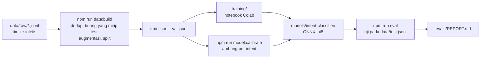

# AI GroUp: data, pelatihan, dan harga pasar

Folder ini berisi semua bahan mentah AI GroUp. Kode yang **memakai** hasilnya ada di [`lib/agent/`](../lib/agent/README.md) (chat) dan `lib/trust/` (cek harga wajar, kartu supplier, radar permintaan).

## Dua AI, dua tugas

| | Classifier intent | Harga pasar |
|---|---|---|
| **Tugas** | Memahami maksud pesan chat pembeli ("cabe 5 kilo" → `pesan_baru`) | Menyediakan harga pasar terkini dan status volatilitas 13 bahan baku |
| **Data** | 20.502 pesan berlabel (`data/`) | Harga 2026 dari tujuh sumber (`harga/dataset/`). Model hanya memakai PIHPS Kota Bandung; SP2KP, Tepas, dan berita menjadi pembanding ([rincian](harga/README.md#sumber-data)) |
| **Model** | IndoBERT-lite, ONNX int8 **12,2 MB** | Naive, rata-rata bergerak 3 bulan, atau exponential smoothing, dipilih per komoditas lewat uji walk-forward |
| **Hasil uji** | Presisi **97,6%** pada pesan yang diterima, 73,8% pesan selesai tanpa LLM | MAPE validasi per komoditas, tercatat di `prediksi.json` |
| **Dipakai di** | Tahap 1 agen chat | Tool `harga_pasar`, cek harga wajar, asisten buka batch, seed demo |
| **Detail** | [`training/`](training/README.md), [model card](../models/intent-classifier/MODEL_CARD.md) | [`harga/`](harga/README.md) |

## Alur classifier intent



`data/test.jsonl` (225 pesan tulisan tim, 25 per intent) tidak pernah dipakai untuk latihan maupun kalibrasi. Baris latih yang mirip atau memuat teks uji dibuang, karena tanpa aturan itu 221 dari 225 pesan uji ternyata ikut masuk ke data latih dan akurasi uji palsu menjadi 100%.

## Isi folder

| Folder / file | Isi |
|---|---|
| `data/raw/team.jsonl` | 275 pesan tulisan tim |
| `data/raw/train_wa.jsonl` | 10.001 pesan sintetis berpola dari rekan tim |
| `data/raw/synthetic.jsonl` | 10.001 pesan sintetis dari `npm run data:generate` |
| `data/test.jsonl` | 225 pesan uji tulisan tim, hanya untuk eval |
| `data/intent_guidelines.md` | Pedoman label 9 intent, lengkap dengan contoh positif dan kasus batas |
| `data/*.ts` | Validasi, pembuatan data sintetis, split, augmentasi, dan kalibrasi ambang (masing-masing punya tes) |
| `training/` | Notebook Colab untuk fine-tuning dan ekspor ONNX |
| `harga/` | Pipeline Python harga pasar PIHPS dan hasilnya (`output/prediksi.json`) |

`data/train.jsonl` dan `data/val.jsonl` tidak di-commit. Buat ulang dengan `npm run data:build`.

## 9 intent

| Intent | Contoh | Diselesaikan oleh |
|---|---|---|
| `pesan_baru` | "kak mau ikut cabe 5 kilo" | Tahap 1 |
| `ubah_pesanan` | "ayam aku jadiin 8 aja" | Tahap 1 |
| `batal_pesanan` | "gak jadi deh cabenya" | Tahap 1 |
| `cek_pesanan` | "pesananku apa aja kak" | Tahap 1 |
| `sapaan` | "pagi min" | Tahap 1 |
| `di_luar_topik` | "bikinin puisi dong" | Tahap 1 |
| `tanya_info` | "kapan bayarnya kak" | Tahap 2 (butuh data batch) |
| `tanya_harga_pasar` | "harga bawang di pasar skrg brp" | Tahap 2 (butuh tool `harga_pasar`) |
| `catat_minat` | "aku butuh keju 10kg tiap minggu" | Tahap 2 (butuh slot bahan dan frekuensi) |

## Perintah

```bash
npm run data:check          # validasi format dataset
npm run data:generate       # tambah data sintetis lewat penyedia tahap 2
npm run data:build          # split train/val/test
npm run model:calibrate     # ambang per intent → models/intent-classifier/thresholds.json
npm run eval -- --mode router   # uji di data/test.jsonl, lihat evals/README.md
```

Pipeline harga pasar punya perintahnya sendiri di [`harga/README.md`](harga/README.md).
