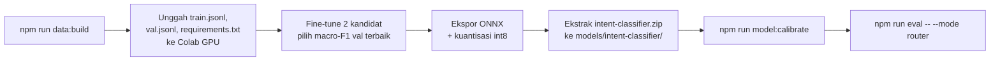

# Pelatihan classifier intent

Notebook `intent_classifier.ipynb` melatih model yang membuat sebagian besar chat pembeli selesai **tanpa LLM**: lebih cepat, lebih murah, dan pesan tidak perlu dikirim ke pihak ketiga.

## Hasil

| | |
|---|---|
| Model dasar | `indobenchmark/indobert-lite-base-p1` (11,7 jt parameter) |
| Ukuran setelah kuantisasi int8 | **12,2 MB** (batas proyek 30 MB) |
| Presisi pada pesan yang diterima | **97,6%** (162 dari 166 pesan uji) |
| Pesan uji selesai tanpa LLM | **73,8%** |
| Latensi CPU p95 | **23,7 ms** |

Angka diambil dari 225 pesan uji tulisan tim yang tidak pernah dilihat saat latihan. Rincian dan batasannya ada di [model card](../../models/intent-classifier/MODEL_CARD.md).

## Kenapa IndoBERT-lite?

| Kandidat | macro-F1 val | Ukuran int8 | Keputusan |
|---|---|---|---|
| `intfloat/multilingual-e5-small` | 0,9767 | > 100 MB | Ditolak, terlalu besar untuk fungsi serverless |
| `indobenchmark/indobert-lite-base-p1` | 1,0000 | 12,2 MB | Dipakai |

Model kecil penting karena classifier berjalan di dalam fungsi Vercel, bersama sisa kode agen.

## Langkah

1. Di root repo, jalankan `npm run data:build` untuk membuat `ai/data/train.jsonl` dan `ai/data/val.jsonl`.
2. Buka `intent_classifier.ipynb` di Colab dengan runtime GPU, lalu unggah `requirements.txt`, `train.jsonl`, dan `val.jsonl`.
3. Jalankan semua sel. Hasilnya `intent-classifier.zip`.
4. Ekstrak ke `models/intent-classifier/`, lalu jalankan `npm run model:calibrate` untuk menghitung ambang per intent (presisi ≥ 97% di val).
5. Ukur di set uji dengan `npm run eval -- --mode router` dan `npm run eval:report`.

Set uji sengaja **tidak** diunggah ke notebook. Angka uji hanya dihitung oleh `npm run eval` di repo.

## Pengaturan

`max_length` 64, learning rate 3e-5, batch 32, maks. 6 epoch dengan early stopping pada macro-F1 val, seed 42. Versi pustaka dipin di `requirements.txt`, kecuali `torch` yang memakai build CUDA bawaan Colab.
