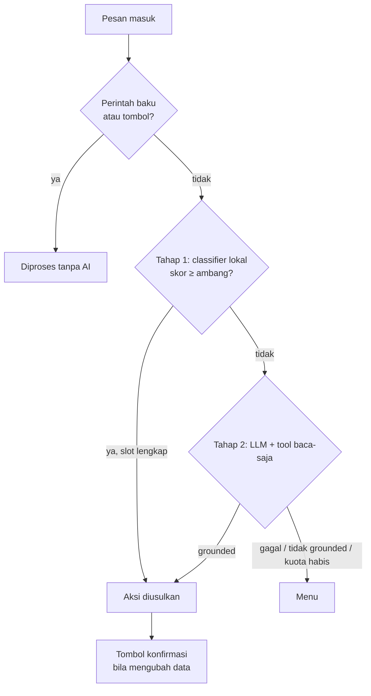
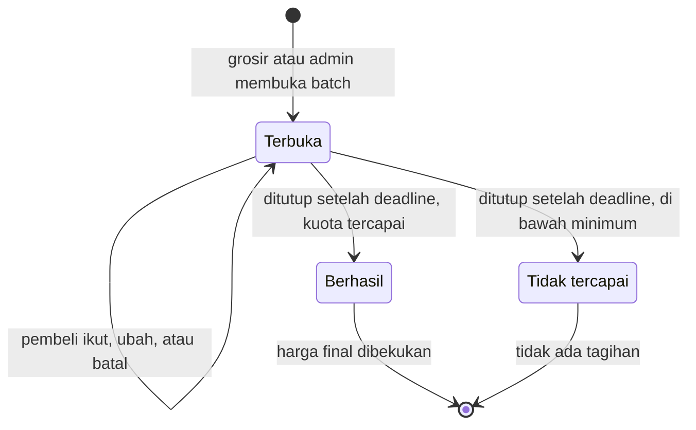
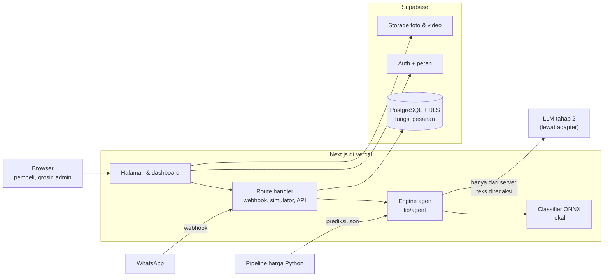

# PRD: GroUp, patungan bahan baku untuk usaha kecil

| | |
|---|---|
| **Versi** | 1.0 (sesuai isi repo per 14 November 2026) |
| **Lomba** | LOGICODIX 2026 Hackathon · Kategori **Web** · Subtema **Local MSME & Creative Economy** |
| **Status** | MVP berjalan di production; code freeze dan submission 14 November 2026, 23.59 WIB |
| **Situs** | https://gro-up-virid.vercel.app |
| **Dokumen terkait** | [README](../README.md) · [Agen AI](../lib/agent/README.md) · [Evaluasi](../evals/README.md) · [Model card](../models/intent-classifier/MODEL_CARD.md) · [Database](../supabase/README.md) |

> **Ringkasan satu kalimat:** GroUp menggabungkan pesanan kecil banyak warung ke dalam satu batch supaya mereka mendapat harga grosir. Pesanan bisa masuk lewat website atau WhatsApp dalam bahasa sehari-hari, dan AI tidak pernah menyimpan apa pun tanpa konfirmasi pembeli.

---

## 1. Ringkasan

**GroUp** adalah aplikasi web dan bot WhatsApp untuk **patungan bahan baku**. Grosir membuka batch dengan harga bertingkat dan kuota minimum. Warung ikut memesan sesuai kebutuhan masing-masing. Kalau kuota tercapai saat deadline, semua pembeli mendapat harga tier yang sama. Kalau tidak tercapai, tidak ada yang ditagih.

**Ide inti:** pembeli kecil tidak harus menjadi besar untuk mendapat harga grosir. Cukup **dikumpulkan**.

**Kalimat pitch:** *beli bareng, harga lebih ringan.* Pesan semudah chat, hemat yang bisa dibuktikan dengan harga pasar resmi.

**Tiga hal yang membedakan GroUp:**

1. **Kanal yang sudah dipakai UMKM.** Pesanan bisa lewat WhatsApp dengan bahasa santai, bukan hanya lewat formulir.
2. **AI yang bisa dipercaya.** AI hanya mengusulkan. Semua yang mengubah data butuh tombol konfirmasi, dan angka di jawaban AI dicek terhadap data.
3. **Hemat yang jujur.** Harga batch dibandingkan langsung dengan harga PIHPS Kota Bandung. Kalau ternyata lebih mahal, itu juga ditampilkan.

### 1.1 Konteks lomba

GroUp dikembangkan untuk **LOGICODIX 2026 Hackathon** bertema *"NextGen Digital Innovation: Crafting Creative Solutions for a Better Society"*. Subtema yang dipilih adalah **Local MSME & Creative Economy**: platform digital yang membantu UMKM lokal memperluas akses pasar dan mengoptimalkan manajemen bisnis. GroUp menjawabnya dengan memberi warung akses ke harga grosir dan memberi grosir akses ke permintaan yang tadinya tersebar.

**Peta ke indikator penilaian**

| Kriteria (bobot) | Kontribusi GroUp | Bukti di repo |
|---|---|---|
| Problem–Solution Fit (25%) | Masalah harga eceran dan permintaan tersebar dijawab dengan patungan; pesan lewat kanal yang sudah dipakai UMKM | Bagian 2–3, `/patungan`, WhatsApp |
| Technology Innovation (25%) | Router dua tahap: classifier lokal hasil latihan sendiri + LLM dengan tool baca-saja; AI kepercayaan berbasis data PIHPS | [`lib/agent/`](../lib/agent/README.md), [`ai/`](../ai/README.md) |
| Software Engineering (25%) | Engine terpisah dari transport, aturan bisnis di fungsi database, tes Vitest + pgTAP + pytest, suite eval, dokumentasi per folder | [`evals/`](../evals/README.md), [`supabase/`](../supabase/README.md) |
| UI/UX (15%) | Pesan semudah chat, tombol konfirmasi, timeline pesanan, simulator dengan panel "Di balik layar", login demo satu klik | Bagian 5 |
| Digital Ethics & Security (10%) | Konfirmasi wajib, grounding, redaksi data pribadi, retensi data, label AI, halaman transparansi, RLS | Bagian 12 |

**Ketentuan lomba yang memengaruhi produk**

- Produk berupa **MVP berbasis Web** yang fitur utamanya bisa dijalankan dan diuji juri tanpa membayar atau akses khusus. Karena itu ada akun demo dan simulator WhatsApp di browser.
- Pengembangan wajib memperhatikan **etika AI, pelindungan data, dan efisiensi sumber daya**. Ketiganya menjadi prinsip desain agen (bagian 8 dan 12).
- `README.md` wajib memuat layanan atau model AI yang dipakai dan bagian produk yang memanfaatkannya, serta atribusi dataset dan layanan pihak ketiga.
- Kredensial hanya di `.env`; repo menyediakan `.env.example` tanpa nilai asli.
- Kuota API dan layanan pendukung harus tetap aktif selama penilaian.

---

## 2. Latar Belakang & Masalah

**Pembeli: belanja kecil, harga eceran**

- Warung dan UMKM kuliner membeli bahan baku sedikit-sedikit, sesuai modal dan kapasitas simpan.
- Harga eceran sudah memuat margin perdagangan dan pengangkutan di setiap mata rantai.
- Harga bahan seperti cabai dan bawang bergejolak, jadi pemilik warung sulit menentukan harga menu.
- Pemilik warung terbiasa memesan lewat chat WhatsApp, bukan aplikasi atau formulir.

**Grosir: tidak melihat permintaan yang tersebar**

- Permintaan dari banyak warung kecil sebenarnya besar bila digabung, tetapi tersebar dan tidak terlihat.
- Grosir tidak tahu bahan apa yang sedang dicari, berapa banyak, dan seberapa sering.
- Mengoordinasikan banyak pembeli kecil secara manual (siapa ikut, berapa, sudah bayar atau belum) memakan waktu.

**Akar masalah yang sama:** tidak ada tempat untuk **mengumpulkan** permintaan kecil menjadi satu pesanan besar dengan aturan yang jelas, harga yang transparan, dan cara pesan yang semudah chat.

---

## 3. Data Pendukung

### 3.1 Harga pasar vs harga patungan

Harga pasar diambil dari PIHPS Bank Indonesia, Kota Bandung, data 2 November 2026 (`ai/harga/output/prediksi.json`). Harga tier adalah harga batch demo dari `scripts/demo/plan.ts`, dibulatkan ke bawah ke Rp100.

| Bahan | Harga pasar /kg | Tier 1 | Tier 2 | Hemat tier 2 | Status harga |
|---|---|---|---|---|---|
| Cabai Merah Keriting | Rp94.100 | Rp86.500 | Rp82.800 | 12% | Bergejolak |
| Bawang Merah | Rp35.000 | Rp32.500 | Rp31.100 | 11% | Bergejolak |
| Bawang Putih | Rp41.250 | Rp38.300 | Rp36.700 | 11% | Stabil |
| Daging Ayam Ras | Rp41.500 | Rp39.800 | Rp39.000 | 6% | Stabil |
| Telur Ayam Ras | Rp25.250 | Rp24.400 | Rp23.900 | 5% | Stabil |
| Minyak Goreng Curah | Rp21.650 | Rp21.000 | Rp20.500 | 5% | Stabil |
| Gula Pasir | Rp19.300 | Rp18.700 | Rp18.300 | 5% | Stabil |
| Beras Medium | Rp15.900 | Rp15.400 | Rp15.100 | 5% | Stabil |

### 3.2 Kenapa hematnya 3–12%, bukan separuh harga

Patungan hanya memangkas **sebagian** margin perdagangan dan pengangkutan, bukan seluruh rantai distribusi. Persentase tier diturunkan dari margin BPS per komoditas:

| Kelompok | Perkiraan margin | Tier 1 memangkas | Tier 2 memangkas |
|---|---|---|---|
| Cabai | ±25% | ±⅓ margin (harga 92%) | ±½ margin (harga 88%) |
| Bawang | ±23% | harga 93% | harga 89% |
| Daging ayam | ±12% | harga 96% | harga 94% |
| Beras, minyak, gula, telur | ±9–11% | harga 97% | harga 95% |

**Poin pitch:** angka hemat sengaja dibuat realistis. Klaim "hemat 50%" mudah dipatahkan juri, sedangkan 3–12% bisa dibuktikan dengan harga pasar resmi yang ditampilkan di setiap batch.

### 3.3 Volatilitas

Pipeline harga (`ai/harga/`) menandai 4 dari 13 komoditas PIHPS sebagai **bergejolak** per 2 November 2026: cabai merah keriting, cabai merah besar, cabai rawit merah, dan bawang merah. Bahan inilah yang paling diuntungkan oleh harga batch yang dikunci di depan.

### 3.4 Perlu dicek dan bukti lapangan

- [ ] Cantumkan publikasi BPS sumber angka margin perdagangan dan pengangkutan di slide.
- [x] Wawancara 1–2 petani atau pengurus koperasi: harga jual ke pengepul, pernah ijon atau tidak, kapan harga paling anjlok.
- [x] Wawancara 1–2 pemilik warung atau katering: belanja cabai per minggu, pernah kehabisan atau tidak, reaksi saat harga naik.
- [x] Ambil 2–3 kutipan terkuat untuk halaman depan, README, dan slide.

---

## 4. Pengguna & Tiga Peran

| Peran | Siapa | Kebutuhan utama | Masalah saat ini |
|---|---|---|---|
| **Pembeli** | Pemilik warung atau usaha kuliner kecil, memesan dari ponsel | Harga lebih murah, pesan semudah chat, tahu kapan bayar dan ambil | Membayar harga eceran, harga bahan naik-turun |
| **Grosir** | Supplier bahan baku | Tahu permintaan, harga yang bersaing, pantau kuota | Permintaan kecil tersebar dan sulit dikoordinasikan |
| **Admin** | Pengelola GroUp | Verifikasi supplier, kelola batch dan pesanan, audit AI | Pembayaran dan penyerahan masih dicatat manual |
| **Juri / pengunjung** | Orang yang menilai produk | Paham masalah dan melihat AI bekerja dalam 2 menit, tanpa mendaftar | — |

**Halaman per peran**

| Halaman | Pembeli (`/akun`) | Grosir (`/grosir`) | Admin (`/admin`) |
|---|---|---|---|
| Ringkasan | Total hemat vs harga pasar, pesanan aktif | Batch aktif, progres kuota | KPI, pembagian pesan per jalur agen |
| Utama | **Pesanan saya**: timeline kuota → bayar → serah, ubah atau batal selama batch buka | **Batch saya** dan **Buka batch** dengan upload foto dan asisten harga | **Batch & pesanan**: tutup batch, catat bayar dan serah |
| Khusus | — | **Radar permintaan** dan **Profil** dengan pratinjau kartu kepercayaan | **Supplier**: verifikasi dan hubungkan akun grosir; **Aktivitas AI** |

**Halaman publik:** beranda showcase, katalog `/patungan`, detail batch, kategori, `/cara-kerja`, `/supplier`, `/pesanan` (kelola pesanan tanpa login), `/simulator`, `/transparansi-ai`, dan `/masuk`.

---

## 5. Prinsip Pengalaman

**Keputusan:** pembeli tidak wajib membuka aplikasi apa pun. WhatsApp adalah jalur utama, dan website adalah jalur kedua yang setara.

### 5.1 Sisi pembeli

- **Bahasa sehari-hari.** "Ikut patungan", "Ya, ikut", "Pesanan saya", bukan istilah teknis.
- **Satu langkah, satu konfirmasi.** Setiap aksi yang mengubah pesanan berakhir di tombol, bukan langsung tersimpan.
- **Hemat terlihat di kartu.** Badge "Hemat x% vs pasar" atau "Lebih mahal x%" tampil di kartu dan detail batch, beserta sumber dan tanggal PIHPS.
- **Status yang jelas.** Timeline pesanan memakai tiga langkah: kuota → pembayaran → penyerahan.
- **Tanpa akun pun bisa.** Pesanan website tanpa login dikelola dengan kode yang ditampilkan sekali.

### 5.2 Sisi grosir dan admin

- **Dashboard** dengan sidebar di desktop dan tab bawah di layar < 768 px.
- **Saran, bukan paksaan.** Asisten harga memberi saran tier dan peringatan, tetapi tidak memblokir penyimpanan.
- **Data kurang → fitur disembunyikan.** Radar tidak menampilkan bahan dengan kurang dari 2 pengirim, dan badge hemat tidak tampil bila satuan tidak cocok.

### 5.3 Sisi juri

- **Coba sebagai …** di `/masuk`: satu klik untuk masuk sebagai pembeli, grosir, atau admin.
- **Simulator WhatsApp** dengan panel "Di balik layar" yang menunjukkan jalur, intent, keyakinan, tool, dan latensi setiap pesan.
- **Label "Dibantu AI"** di setiap fitur AI, menautkan ke `/transparansi-ai`.

---

## 6. Tujuan, Metrik & Model Bisnis

**Tujuan produk**

| # | Tujuan | Ukuran | Status |
|---|---|---|---|
| G1 | Pembeli mendapat harga lebih rendah dari pasar | Harga tier batch 3–12% di bawah harga PIHPS Kota Bandung untuk bahan dan satuan yang sama | ✅ Tercapai pada data demo |
| G2 | Pembeli bisa memesan dengan bahasa sehari-hari | Aksi end-to-end benar ≥ 90% pada set uji percakapan | ⏳ Suite siap, dataset belum ditulis |
| G3 | AI aman dan tidak pernah bertindak sendiri | **0** aksi tersimpan tanpa tombol konfirmasi; 100% skenario injection ditangani aman | ✅ Dijamin oleh desain dan tes; ⏳ suite `safety` belum punya dataset |
| G4 | AI hemat dan cepat | ≥ 60% teks bebas selesai tanpa LLM; p95 tahap 1 < 300 ms | ✅ **73,8%**, **23,7 ms** |
| G5 | Juri paham dan bisa mencoba dalam 2 menit | Video di halaman depan, simulator publik, login demo satu klik untuk tiga peran | ✅ |

**Metrik saat ini** (`evals/REPORT.md`, 225 pesan uji tulisan tim)

| Metrik | Target | Hasil |
|---|---|---|
| Presisi tahap 1 pada pesan yang diterima | ≥ 97% | **97,6%** |
| Teks bebas selesai tanpa LLM | ≥ 60% | **73,8%** |
| Latensi p95 tahap 1 | < 300 ms | **23,7 ms** |
| Akurasi intent / macro-F1 | — | 89,8% / 0,898 |
| Aksi tersimpan tanpa konfirmasi | 0 | Belum diukur suite `e2e`/`safety` |
| Aksi end-to-end benar | ≥ 90% | Belum diukur |

**Metrik pilot** *(hipotesis awal, perlu dikalibrasi dengan data pilot)*

| Metrik | Cara ukur | Target pilot |
|---|---|---|
| Rata-rata hemat pembeli vs PIHPS | Ringkasan pembeli di `/akun` | ≥ 5% |
| Batch berhasil | Batch *berhasil* / batch yang ditutup | ≥ 60% |
| Pembeli berulang | Pembeli yang memesan lagi dalam 30 hari | ≥ 40% |
| Minat menjadi batch | Bahan di radar yang kemudian dibuka batch-nya | ≥ 20% |

**Model bisnis** *(hipotesis, belum diputuskan tim)*

| Sumber pendapatan | Siapa bayar | Skema |
|---|---|---|
| Komisi batch berhasil | Grosir | Persentase kecil dari nilai batch yang berhasil. Batch gagal tidak dikenai biaya |
| Fitur grosir lanjutan | Grosir | Radar permintaan yang lebih rinci dan prioritas tampil di katalog |
| Kemitraan | Koperasi, komunitas UMKM, pemda | Program patungan untuk anggota dan data permintaan bahan pokok |

MVP belum memungut biaya apa pun dan belum memakai pembayaran sungguhan.

---

## 7. Scope MVP & Kebutuhan Fungsional

MVP mencakup **8 bahan pokok** dengan harga pasar **PIHPS Kota Bandung**, tiga peran, website, dan WhatsApp.

- **P0**: tanpa ini produk tidak menyelesaikan masalah inti.
- **P1**: membuat produk jauh lebih baik dan menjadi pembeda.
- **P2**: masuk roadmap, tetapi desain sekarang sudah menyiapkan jalannya.

Status: ✅ selesai · 🟡 sebagian · ⬜ belum.

| ID | Fitur | Kebutuhan dan kriteria penerimaan | Prioritas | Status |
|---|---|---|---|---|
| F1 | Katalog batch | Pencarian, filter kategori, "hampir capai kuota", "tutup ≤ 3 hari", "supplier terverifikasi", dan urutan. Filter tersimpan di URL | P0 | ✅ |
| F2 | Harga bertingkat | Harga per satuan turun sesuai tier kuantitas yang terkumpul. Harga final dibekukan saat batch berhasil | P0 | ✅ |
| F3 | Pesanan website | Tanpa login: kode pengelolaan ditampilkan sekali. Saat login: pesanan tercatat di akun pembeli | P0 | ✅ |
| F4 | Pesanan WhatsApp | `MULAI` → pilih batch → isi jumlah → konfirmasi. `PESANAN`, `UBAH`, `BATAL` berfungsi. Signature webhook diverifikasi, pesan ganda diabaikan | P0 | ✅ |
| F5 | Penutupan batch | Setelah deadline: kuota tercapai → *menunggu bayar*; di bawah minimum → *tidak tercapai*, tanpa tagihan | P0 | ✅ |
| F6 | Konfirmasi wajib | **Given** AI mengusulkan ikut, ubah, batal, atau catat minat, **when** pembeli belum menekan tombol, **then** tidak ada data yang tertulis | P0 | ✅ |
| F7 | Tiga peran | `/admin`, `/grosir`, `/akun` hanya untuk perannya. Peran di `app_metadata`, bukan `user_metadata`. Tanpa pendaftaran publik | P0 | ✅ |
| F8 | Aturan di database | Batch tertutup menolak pesanan, jumlah ≤ 100.000, pesanan hanya dikelola pemiliknya, RLS di semua tabel, diuji pgTAP | P0 | ✅ |
| F9 | Agen teks bebas | Teks bebas dipahami ke salah satu dari 9 intent lewat router dua tahap (bagian 8 dan 9) | P1 | ✅ |
| F10 | Simulator WhatsApp | `/simulator` memakai engine yang sama dengan WhatsApp, lengkap dengan panel "Di balik layar". Maks. 50 pesanan simulator aktif per batch | P1 | ✅ |
| F11 | Cek harga wajar | Badge hemat atau lebih mahal vs PIHPS. Tersembunyi bila nama atau satuan tidak cocok | P1 | ✅ |
| F12 | Kartu kepercayaan supplier | Fakta dari database + ringkasan AI 1–2 kalimat yang grounded. Cache 24 jam | P1 | ✅ |
| F13 | Radar permintaan | Minat per bahan dengan kuantitas mingguan, tren 14 hari, harga pasar. Bahan < 2 pengirim tidak tampil | P1 | ✅ |
| F14 | Asisten buka batch | Saran tier 95% dan 90% dari harga pasar, kuota dari radar, peringatan bila tier ≥ harga pasar | P1 | ✅ |
| F15 | Upload foto batch | Foto dikecilkan di browser lalu diunggah lewat signed URL ke bucket `batch-images` | P1 | ✅ |
| F16 | Mode demo | Login satu klik untuk tiga peran, 8 batch di semua status, reset setiap malam | P1 | ✅ |
| F17 | Pembayaran online | Status bayar sudah terpisah (`not_due`, `due`, `paid`, `refunded`), tinggal diisi webhook gateway | P2 | ⬜ |
| F18 | Notifikasi hasil batch | Engine mengembalikan `Reply[]` tanpa mengirim sendiri, jadi pengirim template Meta bisa ditambah terpisah | P2 | ⬜ |
| F19 | Prediksi harga di agen | `prediksi.json` sudah berisi prediksi, tapi tool `harga_pasar` baru mengekspos harga terakhir | P2 | 🟡 |
| F20 | Data harga harian | Mode harian pipeline (LightGBM) baru diuji dengan data sintetis | P2 | 🟡 |
| F21 | Pendaftaran grosir mandiri, wilayah selain Bandung | Saat ini `/supplier` hanya berisi kontak email, dan harga pasar hanya Kota Bandung | P2 | ⬜ |

**Di luar MVP**

| Tidak dikerjakan | Alasan |
|---|---|
| Integrasi pembayaran dan logistik | Butuh kerja sama dengan payment gateway dan kurir. Admin mencatat status bayar dan serah secara manual |
| Notifikasi proaktif WhatsApp | Pesan di luar jendela 24 jam butuh template yang disetujui Meta |
| Pendaftaran publik | Akun dibuat admin atau `demo:seed`, supaya peran tidak disalahgunakan selama MVP |
| Pesan suara dan gambar di WhatsApp | Agen meminta pembeli mengirim teks |
| Pelatihan ulang otomatis dari chat production | Butuh persetujuan pengguna dan proses kurasi data |
| Aplikasi mobile native | Website mobile-first dan WhatsApp sudah mencakup kebutuhan pembeli |

---

## 8. Fitur AI

AI dipakai di lima titik. Semua mengikuti satu aturan: **angka selalu dari data, dan aksi selalu lewat konfirmasi.**

| ID | Fitur | Input → Output | Pengguna |
|---|---|---|---|
| AI-1 | Pemahaman chat (tahap 1) | "kak mau ikut cabe 5 kilo" → intent `pesan_baru` + slot → tombol "Ya, ikut" untuk 5 kg | Pembeli |
| AI-2 | Agen dengan tool (tahap 2) | "harga bawang di pasar skrg brp" → tool `harga_pasar` → jawaban dengan harga dan tanggal PIHPS | Pembeli |
| AI-3 | Ringkasan kepercayaan supplier | Fakta supplier → 1–2 kalimat ringkasan, dicek dengan `isGrounded` | Pembeli |
| AI-4 | Harga pasar dan volatilitas | Seri PIHPS → harga terkini, status (stabil, bergejolak, …), dan prediksi bulan depan | Pembeli, grosir |
| AI-5 | Radar dan asisten harga | Minat pembeli + harga pasar → sinyal permintaan dan saran tier | Grosir |

### 8.1 Aturan implementasi

- LLM hanya dipanggil dari server. Kunci API tidak pernah dikirim ke browser.
- Output LLM harus berupa satu aksi yang lolos skema Zod. Kalau gagal, dicoba sekali lagi; kalau masih gagal, pembeli mendapat menu.
- Tool tahap 2 hanya bisa **membaca**: `cari_batch`, `detail_batch`, `pesanan_saya` (hanya milik pengirim), dan `harga_pasar`.
- Nominal rupiah, angka di atas 31, dan nama bulan di jawaban harus ada di hasil tool.
- Email, nomor telepon, dan deret angka panjang diredaksi sebelum dikirim ke LLM, termasuk di riwayat chat.
- Maks. 20 panggilan LLM per pengirim per jam, batas waktu 12 detik, dan sakelar darurat `AGENT_ENABLED=false`.
- Setiap balasan AI diberi awalan 🤖, dan balasan AI pertama dalam 24 jam menautkan `/transparansi-ai`.

### 8.2 Pilihan penyedia model tahap 2

| Opsi | Keterangan |
|---|---|
| **Gemini** (`google`), dipakai di production | Model default `gemini-3.5-flash-lite`, tier gratis. Prompt tier gratis dapat dipakai Google untuk pengembangan produk, karena itu redaksi wajib |
| **Vercel AI Gateway** (`gateway`) | Default `nvidia/nemotron-3.5-lightning-free`. Butuh kartu kredit terdaftar di akun Vercel |
| **OpenAI-compatible** (`openai-compatible`) | Endpoint seperti OpenRouter atau NVIDIA NIM, cukup diganti lewat env |

Penyedia dipilih lewat `AGENT_STAGE2_PROVIDER` tanpa mengubah kode fitur (`lib/agent/model-provider.ts`). Konfigurasi yang tidak lengkap mematikan tahap 2 dan teks bebas dibalas menu.

---

## 9. Logika Harga & Agen

### 9.1 Harga bertingkat

- Setiap batch punya **kuota minimum** dan beberapa **tier**: `{ mulai dari kuantitas, harga per satuan }`.
- Harga berjalan mengikuti tier tertinggi yang sudah tercapai oleh total kuantitas terkumpul.
- Saat batch ditutup dan berhasil, **harga final dibekukan** ke setiap pesanan, lalu status bayar berubah menjadi *menunggu bayar*.
- Asisten harga menyarankan tier **95%** dan **90%** dari harga pasar, dibulatkan ke bawah ke Rp100. Kuota minimum disarankan dari kuantitas mingguan di radar, dibulatkan ke atas ke 10.

### 9.2 Router dua tahap

- Ambang tahap 1 dikalibrasi per intent agar presisi di data validasi ≥ 97%.
- Intent yang butuh data (`tanya_info`, `tanya_harga_pasar`, `catat_minat`) selalu diteruskan ke tahap 2.
- Jumlah yang tidak ditulis pembeli tidak pernah dikonfirmasi; agen menanyakannya lebih dulu.

### 9.3 Harga pasar

1. **Data:** CSV harga bulanan 2026 Kota Bandung dari PIHPS, SP2KP, dan berita, untuk 13 komoditas.
2. **Model:** naive, rata-rata bergerak 3 bulan, atau exponential smoothing, dipilih per komoditas lewat uji walk-forward. Model selain naive hanya dipakai bila menang ≥ 10% atas naive.
3. **Hasil saat ini:** 11 dari 13 komoditas memilih **naive**, karena data baru 11 titik bulanan. Fitur ini disebut **"harga pasar terkini + status volatilitas"**, dengan prediksi sebagai pelengkap.
4. **Satuan:** harga hanya dibandingkan bila satuan batch sama dengan satuan PIHPS, tanpa konversi.

---

## 10. Status Batch & Pesanan

**Status pesanan setelah batch berhasil**

| Pembayaran | Penyerahan | Arti di timeline pembeli |
|---|---|---|
| `due` | `pending` | Menunggu pembayaran |
| `paid` | `pending` | Lunas, menunggu penyerahan |
| `paid` | `ready` | Siap diambil |
| `paid` | `collected` / `delivered` | Selesai |
| `refunded` | — | Dana dikembalikan |

**Aturan:**

- Pesanan hanya bisa diubah atau dibatalkan selama batch **terbuka**, dan hanya oleh pemiliknya: kode pengelolaan (website), akun yang sama (login), atau nomor pengirim yang sama (WhatsApp, simulator).
- Status bayar dan serah dicatat admin secara manual pada MVP.
- Semua perubahan pesanan berjalan di **fungsi database** dalam satu transaksi, jadi website, WhatsApp, dan simulator tunduk pada aturan yang sama.

---

## 11. Model Data & Arsitektur

**Stack:**

- Next.js 16 (App Router) + TypeScript, di-deploy ke Vercel, dengan Vercel Schedule untuk pembersihan harian.
- Supabase untuk Auth, PostgreSQL + RLS, dan Storage.
- AI SDK 7 untuk tahap 2; transformers.js + ONNX untuk classifier lokal.
- Pipeline harga dalam Python, dijalankan offline; hasilnya di-commit sebagai `prediksi.json`.

**Tabel database**

| Tabel | Isi | Catatan |
|---|---|---|
| `suppliers` | Nama, status verifikasi, pemilik akun grosir, cache ringkasan kepercayaan | `owner_user_id` unik |
| `patungans` | Batch: bahan, kategori, satuan, kuota minimum, deadline, status, harga final, foto | |
| `patungan_price_tiers` | Tier harga per batch | |
| `orders` | Pesanan: kanal, jumlah, status, status bayar dan serah, akun pembeli | Hanya diubah lewat fungsi database |
| `whatsapp_sessions` | Sesi percakapan dan aksi yang menunggu konfirmasi | Kedaluwarsa otomatis |
| `inbound_messages` | ID pesan masuk | Penangkal pesan ganda |
| `agent_messages` | Riwayat chat untuk konteks agen | Dihapus setelah 30 hari |
| `agent_traces` | Jalur, intent, keyakinan, tool, latensi, token | Tanpa isi pesan, dihapus setelah 90 hari |
| `demand_interests` | Minat bahan dari pembeli | Sumber radar permintaan |

Rincian migrasi dan tes ada di [`supabase/README.md`](../supabase/README.md).

---

## 12. Etika, Keamanan & Non-Fungsional

**Keamanan**

- Peran disimpan di `app_metadata` yang hanya bisa diubah service role. `proxy.ts` membatasi setiap dashboard untuk perannya.
- Row Level Security aktif di semua tabel. Pengunjung anonim tidak bisa membaca pesanan siapa pun.
- Secret key Supabase dan kunci LLM hanya ada di server. Login demo memakai server action, jadi kata sandi demo tidak pernah dikirim ke browser.
- Webhook WhatsApp memverifikasi signature. Endpoint pembersihan butuh `CRON_SECRET`.
- Simulator publik dibatasi 50 pesanan aktif per batch. Rate limit WAF 30 permintaan per menit per IP dipasang sebelum demo (perintahnya ada di README).

**Privasi dan transparansi AI**

- Data pribadi diredaksi sebelum dikirim ke LLM tier gratis.
- `agent_traces` tidak menyimpan isi pesan. Riwayat chat dihapus setelah 30 hari.
- Label "Dibantu AI" dan 🤖 di setiap hasil AI, serta halaman `/transparansi-ai`.
- Model card mencantumkan sumber data, metrik uji, dan kelemahan yang diketahui, termasuk bahwa set uji ditulis tim yang sama dengan sebagian data latih.

Bagian ini menjawab indikator **Digital Ethics & Security (10%)** dan ketentuan karya guidebook tentang etika AI, pelindungan data, dan efisiensi sumber daya.

**Efisiensi (Green IT)**

- Sebagian besar pesan selesai di classifier lokal 12,2 MB, tanpa panggilan LLM.
- Jawaban LLM di eval dan seed demo di-cache, jadi pesan yang sama hanya memanggil model sekali.
- Webhook membalas Meta sebelum pemrosesan AI berjalan (`after()`).

**Kualitas**

- Engine agen bisa diuji tanpa jaringan. Setiap modul punya tes Vitest, aturan database diuji pgTAP, dan pipeline harga diuji pytest.
- Bahasa Indonesia di seluruh antarmuka dan balasan.

---

## 13. Timeline Ringkas

Jadwal lomba mengikuti Guidebook LOGICODIX 2026. Hasil per hari diambil dari riwayat commit.

| Tanggal | Agenda lomba | Hasil GroUp |
|---|---|---|
| Sab 7 Nov | Hacking kick-off, awal pengerjaan | Fondasi: skema batch, tier, dan pesanan; katalog; detail batch; pesanan website; dashboard admin |
| Min 8 Nov | Hacking Week | Engine agen, perintah baku WhatsApp, webhook, simulator, pembersihan data harian |
| Sen 9 Nov | Hacking Week | Tahap 2 dengan tool dan grounding, dataset intent, pipeline harga PIHPS, suite eval |
| Sel 10 Nov | Hacking Week | Upload foto, tiga peran, mode demo, fitur AI kepercayaan, showcase dan video |
| Kam 12 Nov | Hacking Week | Classifier tahap 1 dilatih, dikalibrasi, dan dikirim ke production |
| **Sab 14 Nov** | **Code freeze & batas submission, 23.59 WIB** | Dokumentasi untuk juri: README per folder dan PRD |
| Sab 21 Nov | Pengumuman finalis | — |
