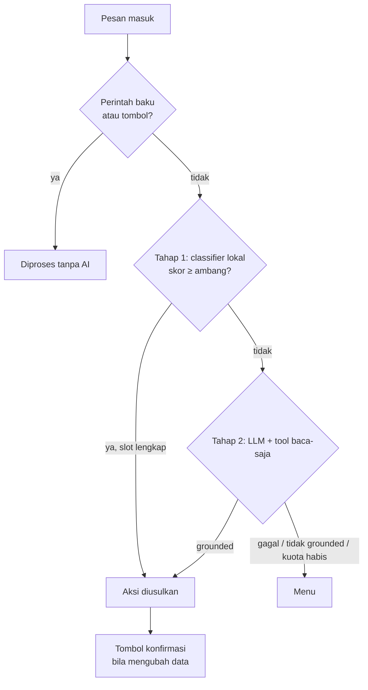
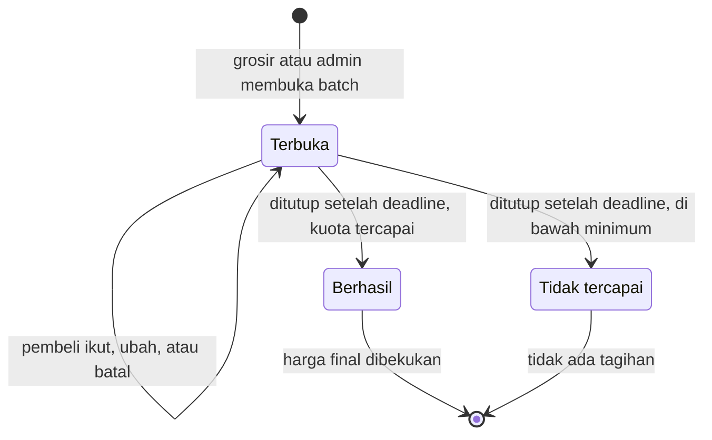
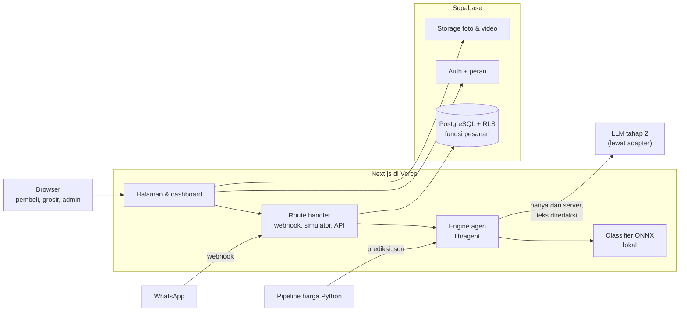

# PRD: GroUp, Patungan Bahan Baku untuk Usaha Kecil

| | |
|---|---|
| **Versi** | 1.0 (sesuai isi repo per 14 November 2026) |
| **Lomba** | LOGICODIX 2026 Hackathon · Kategori **Web** · Subtema **Local MSME & Creative Economy** |
| **Status** | MVP berjalan di production. *Code freeze* dan batas submission: 14 November 2026, 23.59 WIB |
| **Situs** | https://gro-up-virid.vercel.app |
| **Dokumen terkait** | [README](../README.md) · [Agen AI](../lib/agent/README.md) · [Evaluasi](../evals/README.md) · [Model card](../models/intent-classifier/MODEL_CARD.md) · [Database](../supabase/README.md) |

> **Ringkasan:** GroUp menggabungkan pesanan kecil dari banyak warung menjadi satu batch agar mereka mendapat harga grosir. Pembeli memesan lewat website atau WhatsApp dengan bahasa sehari-hari. AI tidak pernah menyimpan data apa pun tanpa konfirmasi pembeli.

---

## 1. Ringkasan

**GroUp** adalah aplikasi web dan bot WhatsApp untuk **patungan bahan baku**. Grosir membuka batch dengan harga bertingkat dan kuota minimum. Warung ikut memesan sesuai kebutuhannya.

- Jika kuota tercapai saat deadline, semua pembeli membayar harga tier yang sama.
- Jika kuota tidak tercapai, tidak ada pembeli yang ditagih.

**Ide inti:** pembeli kecil tidak perlu menjadi besar untuk mendapat harga grosir. Pembeli cukup **dikumpulkan**.

**Kalimat pitch:** *beli bareng, harga lebih ringan.* Pesan semudah chat, dengan penghematan yang dapat dibuktikan lewat harga pasar resmi.

**Tiga pembeda GroUp:**

1. **Kanal yang sudah dipakai UMKM.** Pembeli memesan lewat WhatsApp dengan bahasa santai, tidak hanya lewat formulir.
2. **AI yang dapat dipercaya.** AI hanya mengusulkan. Setiap perubahan data membutuhkan tombol konfirmasi, dan sistem mencocokkan angka di jawaban AI dengan data.
3. **Penghematan yang jujur.** GroUp membandingkan harga batch langsung dengan harga PIHPS Kota Bandung. Jika harga batch lebih mahal, GroUp juga menampilkannya.

### 1.1 Konteks lomba

Tim mengembangkan GroUp untuk **LOGICODIX 2026 Hackathon** dengan tema *"NextGen Digital Innovation: Crafting Creative Solutions for a Better Society"*. Subtema yang dipilih adalah **Local MSME & Creative Economy**, yaitu platform digital yang membantu UMKM lokal memperluas akses pasar dan mengoptimalkan manajemen bisnis.

GroUp menjawab subtema ini dari dua sisi: warung mendapat akses ke harga grosir, dan grosir mendapat akses ke permintaan yang sebelumnya tersebar.

**Peta ke indikator penilaian**

| Kriteria (bobot) | Kontribusi GroUp | Bukti di repo |
|---|---|---|
| Problem–Solution Fit (25%) | Patungan menjawab masalah harga eceran dan permintaan yang tersebar. Pembeli memesan lewat kanal yang sudah biasa dipakai UMKM | Bagian 2–3, `/patungan`, WhatsApp |
| Technology Innovation (25%) | Router dua tahap: classifier lokal hasil latihan sendiri dan LLM dengan tool baca-saja. Fitur AI kepercayaan berbasis data PIHPS | [`lib/agent/`](../lib/agent/README.md), [`ai/`](../ai/README.md) |
| Software Engineering (25%) | Engine terpisah dari transport, aturan bisnis di fungsi database, tes Vitest, pgTAP, dan pytest, suite eval, dan dokumentasi per folder | [`evals/`](../evals/README.md), [`supabase/`](../supabase/README.md) |
| UI/UX (15%) | Pemesanan semudah chat, tombol konfirmasi, timeline pesanan, simulator dengan panel "Di balik layar", dan login demo satu klik | Bagian 5 |
| Digital Ethics & Security (10%) | Konfirmasi wajib, grounding, redaksi data pribadi, retensi data, label AI, halaman transparansi, dan RLS | Bagian 12 |

**Ketentuan lomba yang memengaruhi produk**

- Produk berupa **MVP berbasis web**. Juri harus dapat menjalankan dan menguji fitur utama tanpa membayar atau memakai akses khusus. Karena itu, GroUp menyediakan akun demo dan simulator WhatsApp di browser.
- Pengembangan wajib memperhatikan **etika AI, pelindungan data, dan efisiensi sumber daya**. Ketiganya menjadi prinsip desain agen (bagian 8 dan 12).
- `README.md` wajib mencantumkan layanan atau model AI yang dipakai, bagian produk yang memakainya, serta atribusi dataset dan layanan pihak ketiga.
- Kredensial hanya disimpan di `.env`. Repo menyediakan `.env.example` tanpa nilai asli.
- Kuota API dan layanan pendukung harus tetap aktif selama penilaian.

---

## 2. Latar Belakang dan Masalah

**Pembeli: belanja kecil, harga eceran**

- Warung dan UMKM kuliner membeli bahan baku dalam jumlah kecil, sesuai modal dan kapasitas simpan.
- Harga eceran sudah memuat margin perdagangan dan pengangkutan dari setiap mata rantai.
- Harga cabai dan bawang bergejolak, sehingga pemilik warung sulit menentukan harga menu.
- Pemilik warung terbiasa memesan lewat chat WhatsApp, bukan lewat aplikasi atau formulir.

**Grosir: permintaan tersebar dan tidak terlihat**

- Permintaan banyak warung kecil menjadi besar jika digabung, tetapi tersebar dan tidak terlihat oleh grosir.
- Grosir tidak tahu bahan apa yang dicari, berapa banyak, dan seberapa sering.
- Koordinasi manual dengan banyak pembeli kecil (siapa ikut, berapa banyak, sudah bayar atau belum) menyita waktu.

**Akar masalah:** belum ada tempat untuk **mengumpulkan** permintaan kecil menjadi satu pesanan besar, dengan aturan yang jelas, harga yang transparan, dan cara memesan semudah chat.

---

## 3. Data Pendukung

### 3.1 Harga pasar dibanding harga patungan

Harga pasar berasal dari PIHPS Bank Indonesia untuk Kota Bandung, data 2 November 2026 (`ai/harga/output/prediksi.json`). Harga tier berasal dari batch demo di `scripts/demo/plan.ts`, dibulatkan ke bawah ke kelipatan Rp100.

| Bahan | Harga pasar /kg | Tier 1 | Tier 2 | Hemat tier 2 | Status harga |
|---|---|---|---|---|---|
| Cabai Merah Keriting | Rp94.100 | Rp86.500 | Rp82.800 | 12% | Bergejolak |
| Bawang Merah | Rp35.000 | Rp32.500 | Rp31.100 | 11% | Bergejolak |
| Bawang Putih | Rp41.250 | Rp38.300 | Rp36.700 | 11% | Stabil |
| Daging Ayam Ras | Rp41.500 | Rp39.800 | Rp39.000 | 6% | Stabil |
| Telur Ayam Ras | Rp25.250 | Rp24.400 | Rp23.900 | 5% | Stabil |
| Minyak Goreng Curah | Rp21.650 | Rp21.000 | Rp20.500 | 5% | Stabil |
| Gula Pasir | Rp19.300 | Rp18.700 | Rp18.300 | 5% | Stabil |
| Beras Medium | Rp15.900 | Rp15.400 | Rp15.100 | 5% | Stabil |

### 3.2 Alasan penghematan 3–12%, bukan separuh harga

Patungan hanya memangkas **sebagian** margin perdagangan dan pengangkutan, bukan seluruh rantai distribusi. Persentase setiap tier diturunkan dari margin BPS per komoditas:

| Kelompok | Perkiraan margin | Tier 1 memangkas | Tier 2 memangkas |
|---|---|---|---|
| Cabai | ±25% | ±⅓ margin (harga 92%) | ±½ margin (harga 88%) |
| Bawang | ±23% | harga 93% | harga 89% |
| Daging ayam | ±12% | harga 96% | harga 94% |
| Beras, minyak, gula, telur | ±9–11% | harga 97% | harga 95% |

**Poin pitch:** angka penghematan sengaja dibuat realistis. Juri mudah mematahkan klaim "hemat 50%", sedangkan penghematan 3–12% dapat dibuktikan dengan harga pasar resmi yang tampil di setiap batch.

### 3.3 Volatilitas

Pipeline harga (`ai/harga/`) menandai 4 dari 13 komoditas PIHPS sebagai **bergejolak** per 2 November 2026: cabai merah keriting, cabai merah besar, cabai rawit merah, dan bawang merah. Bahan-bahan inilah yang paling diuntungkan oleh harga batch yang dikunci di awal.

### 3.4 Bukti Lapangan

- ✅ Tim mencantumkan publikasi BPS sebagai sumber angka margin perdagangan dan pengangkutan.
- ✅ Tim mewawancarai 1–2 pemilik warung tentang belanja bahan per minggu, cara memesan, dan reaksi saat harga naik.
- ✅ Tim mewawancarai 1–2 grosir tentang minimum order, cara menentukan harga, dan kesediaan membuka batch.

---

## 4. Pengguna dan Tiga Peran

| Peran | Siapa | Kebutuhan utama | Masalah saat ini |
|---|---|---|---|
| **Pembeli** | Pemilik warung atau usaha kuliner kecil yang memesan dari ponsel | Harga lebih murah, pemesanan semudah chat, kepastian waktu bayar dan ambil | Membayar harga eceran; harga bahan naik-turun |
| **Grosir** | Supplier bahan baku | Informasi permintaan, harga yang bersaing, pemantauan kuota | Permintaan kecil tersebar dan sulit dikoordinasikan |
| **Admin** | Pengelola GroUp | Verifikasi supplier, pengelolaan batch dan pesanan, audit AI | Pembayaran dan penyerahan masih dicatat manual |
| **Juri atau pengunjung** | Orang yang menilai produk | Memahami masalah dan melihat AI bekerja dalam 2 menit tanpa mendaftar | — |

**Halaman per peran**

| Halaman | Pembeli (`/akun`) | Grosir (`/grosir`) | Admin (`/admin`) |
|---|---|---|---|
| Ringkasan | Total penghematan dibanding harga pasar, pesanan aktif | Batch aktif, progres kuota | KPI, pembagian pesan per jalur agen |
| Utama | **Pesanan saya**: timeline kuota → bayar → serah; ubah atau batal selama batch terbuka | **Batch saya** dan **Buka batch** dengan upload foto dan asisten harga | **Batch & pesanan**: tutup batch, catat pembayaran dan penyerahan |
| Khusus | — | **Radar permintaan** dan **Profil** dengan pratinjau kartu kepercayaan | **Supplier**: verifikasi dan hubungkan akun grosir; **Aktivitas AI** |

**Halaman publik:** beranda showcase, katalog `/patungan`, detail batch, kategori, `/cara-kerja`, `/supplier`, `/pesanan` (kelola pesanan tanpa login), `/simulator`, `/transparansi-ai`, dan `/masuk`.

---

## 5. Prinsip Pengalaman

**Keputusan:** pembeli tidak wajib membuka aplikasi apa pun. WhatsApp menjadi jalur utama, dan website menjadi jalur kedua yang setara.

### 5.1 Sisi pembeli

- **Bahasa sehari-hari.** Antarmuka memakai "Ikut patungan", "Ya, ikut", dan "Pesanan saya", bukan istilah teknis.
- **Satu langkah, satu konfirmasi.** Setiap aksi yang mengubah pesanan berakhir di tombol, tidak langsung tersimpan.
- **Penghematan terlihat di kartu.** Badge "Hemat x% vs pasar" atau "Lebih mahal x%" tampil di kartu dan detail batch, beserta sumber dan tanggal data PIHPS.
- **Status yang jelas.** Timeline pesanan terdiri atas tiga langkah: kuota → pembayaran → penyerahan.
- **Dapat dipakai tanpa akun.** Pembeli tanpa login mengelola pesanan website dengan kode yang ditampilkan satu kali.

### 5.2 Sisi grosir dan admin

- **Dashboard** memakai sidebar di desktop dan tab bawah di layar di bawah 768 px.
- **Saran, bukan paksaan.** Asisten harga memberi saran tier dan peringatan, tetapi tidak memblokir penyimpanan.
- **Data kurang, fitur disembunyikan.** Radar tidak menampilkan bahan dengan kurang dari 2 pengirim, dan badge penghematan tidak tampil jika satuan tidak cocok.

### 5.3 Sisi juri

- **Tombol "Coba sebagai …"** di `/masuk` memasukkan juri sebagai pembeli, grosir, atau admin dengan satu klik.
- **Simulator WhatsApp** menampilkan panel "Di balik layar" berisi jalur, intent, keyakinan, tool, dan latensi setiap pesan.
- **Label "Dibantu AI"** tampil di setiap fitur AI dan menautkan ke `/transparansi-ai`.

---

## 6. Tujuan, Metrik, dan Model Bisnis

**Tujuan produk**

| # | Tujuan | Ukuran | Status |
|---|---|---|---|
| G1 | Pembeli mendapat harga lebih rendah dari harga pasar | Harga tier batch 3–12% di bawah harga PIHPS Kota Bandung untuk bahan dan satuan yang sama | ✅ Tercapai pada data demo |
| G2 | Pembeli dapat memesan dengan bahasa sehari-hari | Aksi end-to-end benar ≥ 90% pada set uji percakapan | ⏳ Belum diukur: skenario uji percakapan belum ditulis |
| G3 | AI aman dan tidak pernah bertindak sendiri | **0** aksi tersimpan tanpa tombol konfirmasi; teks pembeli diperlakukan sebagai data, bukan perintah | ✅ Dijamin oleh desain: AI hanya punya tool baca, dan setiap pesanan, perubahan, serta pembatalan menunggu tombol pembeli. Tes unit (`understand.test.ts`, `engine.test.ts`) membuktikannya |
| G4 | AI hemat dan cepat | ≥ 60% teks bebas selesai tanpa LLM; p95 tahap 1 di bawah 300 ms | ✅ **73,8%**, **23,7 ms** |
| G5 | Juri memahami produk dan dapat mencobanya dalam 2 menit | Video di halaman depan, simulator publik, dan login demo satu klik untuk tiga peran | ✅ |

**Metrik saat ini** (`evals/REPORT.md`, 225 pesan uji tulisan tim)

| Metrik | Target | Hasil |
|---|---|---|
| Presisi tahap 1 pada pesan yang diterima | ≥ 97% | **97,6%** |
| Teks bebas yang selesai tanpa LLM | ≥ 60% | **73,8%** |
| Latensi p95 tahap 1 | < 300 ms | **23,7 ms** |
| Akurasi intent / macro-F1 | — | 89,8% / 0,898 |
| Aksi tersimpan tanpa konfirmasi | 0 | Belum diukur: skenario `e2e` dan `safety` belum ditulis |
| Aksi end-to-end benar | ≥ 90% | Belum diukur |

**Metrik pilot** *(hipotesis awal; perlu dikalibrasi dengan data pilot)*

| Metrik | Cara ukur | Target pilot |
|---|---|---|
| Rata-rata penghematan pembeli dibanding PIHPS | Ringkasan pembeli di `/akun` | ≥ 5% |
| Batch berhasil | Batch *berhasil* dibagi batch yang ditutup | ≥ 60% |
| Pembeli berulang | Pembeli yang memesan lagi dalam 30 hari | ≥ 40% |
| Minat menjadi batch | Bahan di radar yang kemudian dibuka batch-nya | ≥ 20% |

**Model bisnis** *(hipotesis; belum diputuskan tim)*

| Sumber pendapatan | Pembayar | Skema |
|---|---|---|
| Komisi batch berhasil | Grosir | Persentase kecil dari nilai batch yang berhasil. Batch gagal tidak dikenai biaya |
| Fitur grosir lanjutan | Grosir | Radar permintaan yang lebih rinci dan prioritas tampil di katalog |
| Kemitraan | Koperasi, komunitas UMKM, pemda | Program patungan untuk anggota dan data permintaan bahan pokok |

MVP belum memungut biaya apa pun dan belum memproses pembayaran sungguhan.

---

## 7. Cakupan MVP dan Kebutuhan Fungsional

MVP mencakup **8 bahan pokok** dengan harga pasar **PIHPS Kota Bandung**, tiga peran, website, dan WhatsApp.

- **P0:** tanpa fitur ini, produk tidak menyelesaikan masalah inti.
- **P1:** fitur ini membuat produk jauh lebih baik dan menjadi pembeda.
- **P2:** fitur ini masuk roadmap, dan desain saat ini sudah menyiapkan jalannya.

Status: ✅ selesai · 🟡 sebagian · ⬜ belum.

| ID | Fitur | Kebutuhan dan kriteria penerimaan | Prioritas | Status |
|---|---|---|---|---|
| F1 | Katalog batch | Pencarian, filter kategori, "hampir capai kuota", "tutup ≤ 3 hari", "supplier terverifikasi", dan urutan. Filter tersimpan di URL | P0 | ✅ |
| F2 | Harga bertingkat | Harga per satuan turun sesuai tier kuantitas yang terkumpul. Sistem membekukan harga final saat batch berhasil | P0 | ✅ |
| F3 | Pesanan website | Tanpa login: sistem menampilkan kode pengelolaan satu kali. Dengan login: pesanan tercatat di akun pembeli | P0 | ✅ |
| F4 | Pesanan WhatsApp | `MULAI` → pilih batch → isi jumlah → konfirmasi. Perintah `PESANAN`, `UBAH`, dan `BATAL` berfungsi. Webhook memverifikasi signature dan mengabaikan pesan ganda | P0 | ✅ |
| F5 | Penutupan batch | Setelah deadline: kuota tercapai → *menunggu bayar*; di bawah minimum → *tidak tercapai*, tanpa tagihan | P0 | ✅ |
| F6 | Konfirmasi wajib | **Given** AI mengusulkan ikut, ubah, batal, atau catat minat, **when** pembeli belum menekan tombol, **then** sistem tidak menulis data apa pun | P0 | ✅ |
| F7 | Tiga peran | `/admin`, `/grosir`, dan `/akun` hanya terbuka untuk perannya. Peran tersimpan di `app_metadata`, bukan `user_metadata`. Tidak ada pendaftaran publik | P0 | ✅ |
| F8 | Aturan di database | Batch tertutup menolak pesanan, jumlah maksimal 100.000, pesanan hanya dikelola pemiliknya, RLS aktif di semua tabel, dan semuanya diuji pgTAP | P0 | ✅ |
| F9 | Agen teks bebas | Router dua tahap memetakan teks bebas ke salah satu dari 9 intent (bagian 8 dan 9) | P1 | ✅ |
| F10 | Simulator WhatsApp | `/simulator` memakai engine yang sama dengan WhatsApp, lengkap dengan panel "Di balik layar". Maksimal 50 pesanan simulator aktif per batch | P1 | ✅ |
| F11 | Cek harga wajar | Badge hemat atau lebih mahal dibanding PIHPS. Badge disembunyikan jika nama atau satuan tidak cocok | P1 | ✅ |
| F12 | Kartu kepercayaan supplier | Fakta dari database dan ringkasan AI 1–2 kalimat yang grounded. Cache 24 jam | P1 | ✅ |
| F13 | Radar permintaan | Minat per bahan dengan kuantitas mingguan, tren 14 hari, dan harga pasar. Bahan dengan kurang dari 2 pengirim tidak tampil | P1 | ✅ |
| F14 | Asisten buka batch | Saran tier 95% dan 90% dari harga pasar, kuota dari radar, dan peringatan jika tier ≥ harga pasar | P1 | ✅ |
| F15 | Upload foto batch | Browser mengecilkan foto, lalu mengunggahnya lewat signed URL ke bucket `batch-images` | P1 | ✅ |
| F16 | Mode demo | Login satu klik untuk tiga peran, 8 batch di semua status, dan reset setiap malam | P1 | ✅ |
| F17 | Pembayaran online | Status bayar sudah terpisah (`not_due`, `due`, `paid`, `refunded`) dan tinggal diisi oleh webhook gateway pembayaran | P2 | ⬜ |
| F18 | Notifikasi hasil batch | Engine mengembalikan `Reply[]` tanpa mengirim sendiri, sehingga pengirim template Meta dapat ditambahkan terpisah | P2 | ⬜ |
| F19 | Prediksi harga di agen | `prediksi.json` sudah berisi prediksi, tetapi tool `harga_pasar` baru menampilkan harga terakhir | P2 | 🟡 |
| F20 | Data harga harian | Mode harian pipeline (LightGBM) baru diuji dengan data sintetis | P2 | 🟡 |
| F21 | Pendaftaran grosir mandiri dan wilayah di luar Bandung | Saat ini `/supplier` hanya berisi kontak email, dan harga pasar hanya mencakup Kota Bandung | P2 | ⬜ |

**Di luar MVP**

| Tidak dikerjakan | Alasan |
|---|---|
| Integrasi pembayaran dan logistik | Membutuhkan kerja sama dengan payment gateway dan kurir. Admin mencatat status bayar dan serah secara manual |
| Notifikasi proaktif WhatsApp | Pesan di luar jendela 24 jam membutuhkan template yang disetujui Meta |
| Pendaftaran publik | Admin atau `demo:seed` membuat akun, agar peran tidak disalahgunakan selama MVP |
| Pesan suara dan gambar di WhatsApp | Agen meminta pembeli mengirim teks |
| Pelatihan ulang otomatis dari chat production | Membutuhkan persetujuan pengguna dan proses kurasi data |
| Aplikasi mobile native | Website mobile-first dan WhatsApp sudah memenuhi kebutuhan pembeli |

---

## 8. Fitur AI

GroUp memakai AI di lima titik. Kelimanya mengikuti satu aturan: **angka selalu berasal dari data, dan aksi selalu melalui konfirmasi.**

| ID | Fitur | Input → Output | Pengguna |
|---|---|---|---|
| AI-1 | Pemahaman chat (tahap 1) | "kak mau ikut cabe 5 kilo" → intent `pesan_baru` dan slot → tombol "Ya, ikut" untuk 5 kg | Pembeli |
| AI-2 | Agen dengan tool (tahap 2) | "harga bawang di pasar skrg brp" → tool `harga_pasar` → jawaban dengan harga dan tanggal PIHPS | Pembeli |
| AI-3 | Ringkasan kepercayaan supplier | Fakta supplier → ringkasan 1–2 kalimat yang dicek dengan `isGrounded` | Pembeli |
| AI-4 | Harga pasar dan volatilitas | Seri PIHPS → harga terkini, status (stabil, bergejolak, dan lainnya), serta prediksi bulan depan | Pembeli, grosir |
| AI-5 | Radar dan asisten harga | Minat pembeli dan harga pasar → sinyal permintaan dan saran tier | Grosir |

### 8.1 Aturan implementasi

- Hanya server yang memanggil LLM. Kunci API tidak pernah dikirim ke browser.
- Output LLM harus berupa satu aksi yang lolos skema Zod. Jika gagal, sistem mencoba sekali lagi. Jika masih gagal, pembeli menerima menu.
- Tool tahap 2 hanya dapat **membaca**: `cari_batch`, `detail_batch`, `pesanan_saya` (khusus milik pengirim), dan `harga_pasar`.
- Setiap nominal rupiah, angka di atas 31, dan nama bulan di jawaban harus ada di hasil tool.
- Sistem meredaksi email, nomor telepon, dan deret angka panjang sebelum mengirim teks ke LLM, termasuk riwayat chat.
- Batas: maksimal 20 panggilan LLM per pengirim per jam, waktu tunggu 12 detik, dan sakelar darurat `AGENT_ENABLED=false`.
- Setiap balasan AI diawali 🤖. Balasan AI pertama dalam 24 jam menautkan ke `/transparansi-ai`.

### 8.2 Pilihan penyedia model tahap 2

| Opsi | Keterangan |
|---|---|
| **Gemini** (`google`), dipakai di production | Model default `gemini-3.5-flash-lite`, tier gratis. Google dapat memakai prompt tier gratis untuk mengembangkan produknya, sehingga redaksi wajib dilakukan |
| **Vercel AI Gateway** (`gateway`) | Model default `nvidia/nemotron-3.5-lightning-free`. Membutuhkan kartu kredit terdaftar di akun Vercel |
| **OpenAI-compatible** (`openai-compatible`) | Endpoint seperti OpenRouter atau NVIDIA NIM, cukup diganti lewat env |

Variabel `AGENT_STAGE2_PROVIDER` memilih penyedia tanpa mengubah kode fitur (`lib/agent/model-provider.ts`). Jika konfigurasi tidak lengkap, sistem mematikan tahap 2 dan membalas teks bebas dengan menu.

---

## 9. Logika Harga dan Agen

### 9.1 Harga bertingkat

- Setiap batch punya **kuota minimum** dan beberapa **tier**: `{ mulai dari kuantitas, harga per satuan }`.
- Harga berjalan mengikuti tier tertinggi yang sudah dicapai oleh total kuantitas terkumpul.
- Saat batch ditutup dan berhasil, sistem **membekukan harga final** di setiap pesanan dan mengubah status bayar menjadi *menunggu bayar*.
- Asisten harga menyarankan tier **95%** dan **90%** dari harga pasar, dibulatkan ke bawah ke kelipatan Rp100. Asisten menyarankan kuota minimum dari kuantitas mingguan di radar, dibulatkan ke atas ke kelipatan 10.

### 9.2 Router dua tahap

- Ambang tahap 1 dikalibrasi per intent agar presisi di data validasi mencapai minimal 97%.
- Intent yang membutuhkan data (`tanya_info`, `tanya_harga_pasar`, `catat_minat`) selalu diteruskan ke tahap 2.
- Agen tidak pernah meminta konfirmasi untuk jumlah yang tidak ditulis pembeli. Agen menanyakan jumlahnya lebih dulu.

### 9.3 Harga pasar

1. **Data:** CSV harga 2026 dari tujuh sumber: PIHPS Bank Indonesia, SP2KP Kemendag (via Databoks), Tepas Jabar (via Databoks), rilis Disdagin Kota Bandung, dan berita yang mengutip harga pasar. Model dan aplikasi hanya memakai **PIHPS Kota Bandung** (341 baris, Januari–2 November 2026) untuk 13 komoditas. Sumber lain berlevel Jawa Barat atau berupa kutipan berita, sehingga hanya dipakai sebagai pembanding saat analisis. Daftar lengkapnya ada di [`ai/harga/README.md`](../ai/harga/README.md#sumber-data).
2. **Model:** naive, rata-rata bergerak 3 bulan, atau exponential smoothing. Uji walk-forward memilih model per komoditas. Model selain naive hanya dipakai jika unggul minimal 10% atas naive.
3. **Hasil saat ini:** 11 dari 13 komoditas memilih **naive**, karena data baru berisi 11 titik bulanan. Karena itu, fitur ini disebut **"harga pasar terkini + status volatilitas"**, dengan prediksi sebagai pelengkap.
4. **Satuan:** sistem hanya membandingkan harga jika satuan batch sama dengan satuan PIHPS, tanpa konversi.

---

## 10. Status Batch dan Pesanan

**Status pesanan setelah batch berhasil**

| Pembayaran | Penyerahan | Arti di timeline pembeli |
|---|---|---|
| `due` | `pending` | Menunggu pembayaran |
| `paid` | `pending` | Lunas, menunggu penyerahan |
| `paid` | `ready` | Siap diambil |
| `paid` | `collected` / `delivered` | Selesai |
| `refunded` | — | Dana dikembalikan |

**Aturan:**

- Pesanan hanya dapat diubah atau dibatalkan selama batch **terbuka**, dan hanya oleh pemiliknya: lewat kode pengelolaan (website), akun yang sama (login), atau nomor pengirim yang sama (WhatsApp dan simulator).
- Pada MVP, admin mencatat status bayar dan serah secara manual.
- **Fungsi database** menjalankan setiap perubahan pesanan dalam satu transaksi, sehingga website, WhatsApp, dan simulator mengikuti aturan yang sama.

---

## 11. Model Data dan Arsitektur

**Stack:**

- Next.js 16 (App Router) dan TypeScript, di-deploy ke Vercel, dengan Vercel Schedule untuk pembersihan harian.
- Supabase untuk Auth, PostgreSQL dengan RLS, dan Storage.
- AI SDK 7 untuk tahap 2, serta transformers.js dan ONNX untuk classifier lokal.
- Pipeline harga berbasis Python yang dijalankan offline. Hasilnya di-commit sebagai `prediksi.json`.

**Tabel database**

| Tabel | Isi | Catatan |
|---|---|---|
| `suppliers` | Nama, status verifikasi, pemilik akun grosir, cache ringkasan kepercayaan | `owner_user_id` unik |
| `patungans` | Batch: bahan, kategori, satuan, kuota minimum, deadline, status, harga final, foto | |
| `patungan_price_tiers` | Tier harga per batch | |
| `orders` | Pesanan: kanal, jumlah, status, status bayar dan serah, akun pembeli | Hanya diubah lewat fungsi database |
| `whatsapp_sessions` | Sesi percakapan dan aksi yang menunggu konfirmasi | Kedaluwarsa otomatis |
| `inbound_messages` | ID pesan masuk | Mencegah pesan ganda diproses dua kali |
| `agent_messages` | Riwayat chat untuk konteks agen | Dihapus setelah 30 hari |
| `agent_traces` | Jalur, intent, keyakinan, tool, latensi, token | Tanpa isi pesan; dihapus setelah 90 hari |
| `demand_interests` | Minat bahan dari pembeli | Sumber data radar permintaan |

Rincian migrasi dan tes ada di [`supabase/README.md`](../supabase/README.md).

---

## 12. Etika, Keamanan, dan Non-Fungsional

**Keamanan**

- Peran tersimpan di `app_metadata`, yang hanya dapat diubah oleh service role. `proxy.ts` membatasi setiap dashboard untuk perannya.
- Row Level Security aktif di semua tabel. Pengunjung anonim tidak dapat membaca pesanan siapa pun.
- Secret key Supabase dan kunci LLM hanya tersimpan di server. Login demo memakai server action, sehingga kata sandi demo tidak pernah dikirim ke browser.
- Webhook WhatsApp memverifikasi signature. Endpoint pembersihan membutuhkan `CRON_SECRET`.
- Simulator publik dibatasi 50 pesanan aktif per batch. Tim memasang rate limit WAF 30 permintaan per menit per IP sebelum demo; perintahnya tercantum di README.

**Privasi dan transparansi AI**

- Sistem meredaksi data pribadi sebelum mengirim teks ke LLM tier gratis.
- `agent_traces` tidak menyimpan isi pesan, dan sistem menghapus riwayat chat setelah 30 hari.
- Label "Dibantu AI" dan 🤖 tampil di setiap hasil AI, dan halaman `/transparansi-ai` menjelaskan cara kerjanya.
- Model card mencantumkan sumber data, metrik uji, dan kelemahan yang diketahui, termasuk fakta bahwa set uji ditulis oleh tim yang juga menulis sebagian data latih.

Bagian ini menjawab indikator **Digital Ethics & Security (10%)** serta ketentuan guidebook tentang etika AI, pelindungan data, dan efisiensi sumber daya.

**Efisiensi (Green IT)**

- Classifier lokal berukuran 12,2 MB menyelesaikan sebagian besar pesan tanpa memanggil LLM.
- Sistem menyimpan jawaban LLM di cache untuk eval dan seed demo, sehingga pesan yang sama hanya memanggil model satu kali.
- Webhook membalas Meta sebelum pemrosesan AI berjalan (`after()`).

**Kualitas**

- Engine agen dapat diuji tanpa jaringan. Setiap modul punya tes Vitest, aturan database diuji dengan pgTAP, dan pipeline harga diuji dengan pytest.
- Seluruh antarmuka dan balasan memakai bahasa Indonesia.

---

## 13. Linimasa Ringkas

Jadwal lomba mengikuti Guidebook LOGICODIX 2026. Hasil per hari diambil dari riwayat commit.

| Tanggal | Agenda lomba | Hasil GroUp |
|---|---|---|
| Sab 7 Nov | Hacking kick-off, awal pengerjaan | Fondasi: skema batch, tier, dan pesanan; katalog; detail batch; pesanan website; dashboard admin |
| Min 8 Nov | Hacking Week | Engine agen, perintah baku WhatsApp, webhook, simulator, pembersihan data harian |
| Sen 9 Nov | Hacking Week | Tahap 2 dengan tool dan grounding, dataset intent, pipeline harga PIHPS, suite eval |
| Sel 10 Nov | Hacking Week | Upload foto, tiga peran, mode demo, fitur AI kepercayaan, showcase dan video |
| Kam 12 Nov | Hacking Week | Classifier tahap 1 dilatih, dikalibrasi, dan dikirim ke production |
| **Sab 14 Nov** | **Code freeze dan batas submission, 23.59 WIB** | Dokumentasi untuk juri: README per folder dan PRD |
| Sab 21 Nov | Pengumuman finalis | — |
