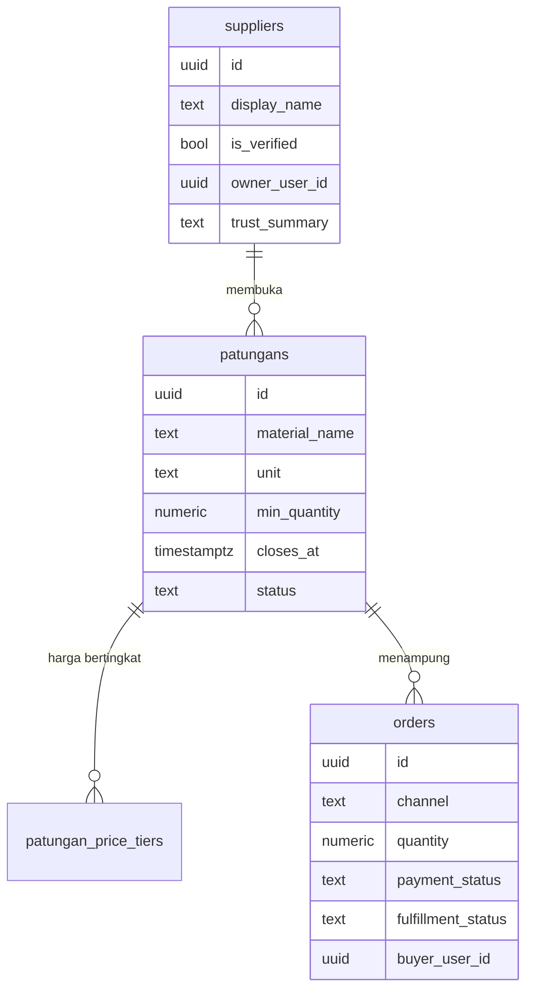

# Database GroUp (Supabase)

Semua aturan bisnis yang penting dijaga di database, bukan hanya di aplikasi. Website, WhatsApp, dan simulator memanggil fungsi SQL yang sama, jadi ketiganya tidak bisa saling melanggar aturan.

## Yang dijaga database

| Aturan | Cara |
|---|---|
| Pesanan hanya masuk ke batch yang masih buka, dengan jumlah wajar (≤ 100.000) | Fungsi `create_group_order` dan constraint di `orders` |
| Pesanan hanya bisa diubah atau dibatalkan selama batch terbuka, oleh pemiliknya | Fungsi `manage_group_order` |
| Saat batch ditutup, harga final dibekukan, atau batch dinyatakan *tidak tercapai* | Fungsi `close_group_batch` |
| Paling banyak 50 pesanan simulator aktif per batch | Fungsi `create_group_order` |
| Pengunjung anonim tidak bisa membaca pesanan siapa pun | Row Level Security di semua tabel |
| Hanya server (service role) yang bisa mereset demo atau menghubungkan akun grosir | Hak eksekusi fungsi |
| Riwayat chat dihapus setelah 30 hari, trace setelah 90 hari | Fungsi `cleanup_agent_data`, dipanggil setiap malam |

## Tabel utama



Tabel pendukung agen: `whatsapp_sessions` (sesi percakapan), `inbound_messages` (penangkal pesan ganda), `agent_messages` (riwayat chat), `agent_traces` (jejak keputusan AI), dan `demand_interests` (minat untuk radar permintaan).

## Migrasi

Terapkan berurutan lewat `supabase db push` atau SQL Editor.

| Migrasi | Isi |
|---|---|
| `20261030165820_create_patungan_ordering.sql` | Skema awal: supplier, batch, tier harga, pesanan, sesi WhatsApp, fungsi pesan dan tutup batch |
| `20261103090000_align_with_design.sql` | Batas jumlah wajar, catatan verifikasi supplier, status bayar dan serah, riwayat batch selesai |
| `20261106090000_agent_router.sql` | Kanal `simulator`, tabel `agent_messages`, `agent_traces`, `demand_interests`, kolom `channel` dan `pending_action` di `whatsapp_sessions`, batas 50 pesanan simulator aktif per batch, fungsi `purge_simulator_orders` dan `cleanup_agent_data` |
| `20261111090000_market_prices.sql` | Katalog komoditas dan snapshot harga pasar di database |
| `20261111100000_drop_market_prices.sql` | Menghapus tabel migrasi sebelumnya, karena harga pasar kini dibaca dari `ai/harga/output/prediksi.json` |
| `20261112090000_storage_buckets.sql` | Bucket `batch-images` (foto batch, 5 MB) dan `site-media` (video, 50 MB) |
| `20261113090000_roles_and_demo.sql` | `suppliers.owner_user_id`, `orders.buyer_user_id`, kolom `tools` di trace agen, penanda `demo_seed`, fungsi `link_supplier_owner` dan `reset_demo_data` |
| `20261114090000_supplier_trust.sql` | Cache ringkasan kepercayaan supplier |

## Tes

Tes pgTAP di `tests/` memeriksa aturan di atas langsung di Postgres:

| File | Jumlah cek | Contoh |
|---|---|---|
| `agent_router.test.sql` | 17 | Pesanan simulator ke-51 ditolak, pembersihan data agen |
| `roles_and_demo.test.sql` | 16 | `anon` dan `authenticated` tidak bisa mereset demo atau membaca pesanan |
| `storage_buckets.test.sql` | 3 | Batas ukuran dan jenis file tiap bucket |

```bash
supabase start
supabase db reset
supabase test db
```

Butuh Docker dan Supabase CLI. Konfigurasi lokal (Postgres 17) ada di `config.toml`.
